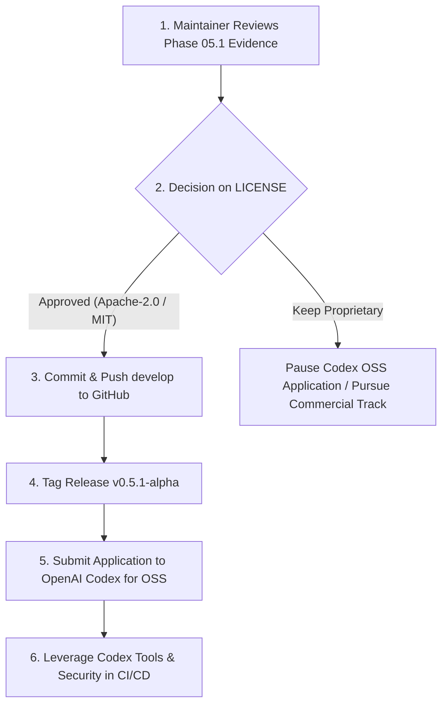

# CHARGEMESH — OPENAI CODEX FOR OPEN SOURCE READINESS AUDIT
## Strategic Program Evaluation, Eligibility Assessment & Engineering Governance

**Document ID:** CM-GOV-CODEX-OSS-001  
**Project:** ChargeMesh EV Charging Interoperability Platform  
**Repository:** `https://github.com/abhayksingh614/chargemesh-app`  
**GitHub Owner:** `abhayksingh614`  
**Primary Maintainer:** Abhay Kumar Singh (Founder & Lead Architect)  
**Target Program:** OpenAI Codex for Open Source Program (`https://developers.openai.com/community/codex-for-oss`)  
**Application Portal:** `https://openai.com/form/codex-for-oss/`  
**Commercial Exploration Track:** OpenAI Partner Network (`https://openai.com/business/partners/`)  
**Evaluation Date:** 2026-11-20  
**Current Assessment Status:** **TECHNICALLY PRE-QUALIFIED | ADMINISTRATIVELY BLOCKED ON LICENSING DECISION**

---

## 1. Executive Summary

This document establishes the strategic, technical, and governance readiness of the ChargeMesh repository for formal application to the **OpenAI Codex for Open Source Program**.

ChargeMesh is an open-standard Electric Vehicle (EV) Charging Management Platform connecting drivers, charging operators (CPOs), OCPP-compatible charging infrastructure, and financial settlement networks. The project has undergone extensive production hardening (Phases 00 through 05.1), featuring real-time OCPP 1.6-J protocol telemetry, double-entry financial ledger accounting, Razorpay raw-body webhook cryptographic verification, and full-stack integration across React Native mobile and Next.js 14 administrative portals.

### High-Level Verdict
- **Engineering Quality & Technical Depth:** **STRONG (Exceeds Criteria)**. 109 automated unit/integration tests passing (100% pass rate), zero TypeScript errors across 5 workspaces, production builds passing, robust DevSecOps controls.
- **Maintainer Leadership & Repository Structure:** **STRONG**. Single dedicated founder/maintainer (`abhayksingh614`), clean commit history, structured governance documents (`CONTRIBUTING.md`, `CODE_OF_CONDUCT.md`, `SECURITY.md`, `DEVELOPMENT_RULES.md`).
- **Critical Administrative Blocker:** **`LIC-001` (License Selection Pending)**. The repository root contains an All-Rights-Reserved `PROPRIETARY SOFTWARE LICENSE`. OpenAI's program mandates an approved OSI open-source license (such as MIT or Apache-2.0). The application cannot be formally submitted until the maintainer executes this decision.

---

## 2. Official Program Requirements

According to OpenAI's published criteria for the Codex for Open Source Program:

1. **Open-Source Status:** The project must be governed by a recognized OSI-approved open-source license.
2. **Active Maintenance & Leadership:** The applicant must be a primary maintainer or core contributor with commit authority and verifiable recent activity.
3. **Public Repository:** The source code must be hosted on a public repository (typically GitHub) with clean documentation.
4. **Demonstrable Technical Quality:** The codebase must feature structured architecture, automated testing, clear build instructions, and security hygiene.
5. **Ecosystem Value & Impact:** The software must solve a genuine problem in the developer, infrastructure, or technology ecosystem.
6. **Legitimate Use of OpenAI Tools:** Intended use of benefits (ChatGPT Pro with Codex, Codex Security, potential API credits) must directly enhance maintainer productivity, test automation, and code security.

---

## 3. Current Project Eligibility Assessment

| Criterion | Requirement | ChargeMesh Current State | Eligibility Verdict |
| :--- | :--- | :--- | :--- |
| **Open Source License** | OSI-Approved (MIT, Apache-2.0, BSD, GPL) | Currently `PROPRIETARY SOFTWARE LICENSE` (decision pending) | 🔴 **BLOCKED** |
| **Maintainer Authority** | Core Maintainer with Repo Ownership | Abhay Kumar Singh (`abhayksingh614`) is Founder & Primary Maintainer | 🟢 **ELIGIBLE** |
| **Public Visibility** | Public GitHub Repository | Repository hosted at `github.com/abhayksingh614/chargemesh-app` | 🟢 **ELIGIBLE** |
| **Technical Substance** | Real-world, non-trivial engineering | Full EV platform (NestJS, OCPP 1.6-J, PostGIS, Next.js 14, React Native) | 🟢 **STRONG FIT** |
| **Test Coverage** | Automated test suite with reproducible CI | 109 passing tests; 100% monorepo typecheck; reproducible builds | 🟢 **STRONG FIT** |
| **Security Posture** | Vulnerability reporting, secrets management | `SECURITY.md` SLA, rawBody HMAC, fail-closed blacklist, zero leaked keys | 🟢 **STRONG FIT** |
| **Documentation** | Architectural guides, onboarding, schemas | 40+ engineering reports, API specs, C4 architecture diagrams | 🟢 **STRONG FIT** |

---

## 4. Repository & Maintainer Readiness

### 4.1 Maintainer Profile & Ownership
- **Maintainer:** Abhay Kumar Singh
- **GitHub Username:** `abhayksingh614`
- **Ownership Verification:** Owns the primary repository namespace `abhayksingh614/chargemesh-app`.
- **Maintainer Role:** Full administrative control, lead software architect, and sole release gatekeeper.
- **Commit History:** Active commit history demonstrating continuous development across architectural milestones.

### 4.2 Governance Hygiene
The repository adheres to established open-source community standards:
- [`CONTRIBUTING.md`](file:///c:/Users/aksde/Videos/My_Codex/Chargemesh_app/CONTRIBUTING.md): Outlines PR submission processes, coding guidelines, branch strategy (`develop` -> `main`), and local testing mandates.
- [`CODE_OF_CONDUCT.md`](file:///c:/Users/aksde/Videos/My_Codex/Chargemesh_app/CODE_OF_CONDUCT.md): Implements Contributor Covenant v2.1 with formal reporting channels (`conduct@chargemesh.in`).
- [`SECURITY.md`](file:///c:/Users/aksde/Videos/My_Codex/Chargemesh_app/SECURITY.md): Defines responsible disclosure guidelines, severity classifications, and a 48-hour response SLA.
- [`THIRD_PARTY_NOTICES.md`](file:///c:/Users/aksde/Videos/My_Codex/Chargemesh_app/THIRD_PARTY_NOTICES.md): Maps all dependency licenses and SPDX identifiers.
- [`DEVELOPMENT_RULES.md`](file:///c:/Users/aksde/Videos/My_Codex/Chargemesh_app/DEVELOPMENT_RULES.md): 40-section engineering, security, testing, and CPO protocol standard.

---

## 5. Licensing Assessment & Pending Owner Decision

### 5.1 The Blocker (`LIC-001`)
The root `LICENSE` file currently contains an exclusive proprietary software license. Applying to the OpenAI Codex for Open Source Program under a proprietary license will result in immediate administrative disqualification.

### 5.2 Comparative Analysis for Maintainer Consideration

```
┌──────────────────────────────────────┬──────────────────────────────────────┐
│             MIT License              │          Apache-2.0 License          │
├──────────────────────────────────────┼──────────────────────────────────────┤
│ • Extreme simplicity (1 page)        │ • Comprehensive legal framework      │
│ • Maximum adoption by indie devs     │ • Express patent grant protection    │
│ • Permissive: allows commercial use  │ • Explicit trademark restrictions    │
│ • Minimal legal overhead             │ • Standard for hardware/IoT protocols│
│ • Preferred for consumer apps        │ • Preferred for EV/OCPP ecosystems   │
└──────────────────────────────────────┴──────────────────────────────────────┘
```

> **Engineering Recommendation:** For an EV charging protocol and IoT infrastructure platform that interacts with physical charging hardware and patentable communication protocols, the **Apache-2.0 License** offers superior legal defense through explicit patent grants, while remaining fully OSI-compliant and eligible for OpenAI Codex for Open Source.

*Note: Per master engineering directives, the `LICENSE` file remains strictly untouched until formal written maintainer authorization.*

---

## 6. Engineering Quality & Technical Evidence

ChargeMesh provides verifiable, objective proof of software engineering rigor across all packages:

### 6.1 Automated Quality Gate Metrics
```
================================================================================
Metric                           Recorded Value              Audit Verification
================================================================================
Monorepo Typecheck               5 / 5 Workspaces PASS       tsc --noEmit (Code 0)
Backend Unit/Spec Tests          15 / 15 Suites (90 Tests)   Jest (100% Pass)
Admin Web Portal Tests           2 / 2 Suites (10 Tests)     Jest (100% Pass)
Mobile Driver Tests              2 / 2 Suites (9 Tests)      Jest (100% Pass)
Total Automated Test Cases       109 Passing / 0 Failing     Zero Skipped Tests
Backend Production Build         SUCCESS (Code 0)            NestJS CLI dist/
Admin Portal Production Build    SUCCESS (Code 0)            Next.js 14 (19/19 routes)
Container Build Capability       Multi-stage Alpine          Backend & Admin Dockerfiles
================================================================================
```

### 6.2 Key Architectural Subsystems
1. **OCPP 1.6-J Protocol Hub:** Live WebSocket server handling `BootNotification`, `Heartbeat`, `StatusNotification`, `StartTransaction`, `StopTransaction`, and `MeterValues`.
2. **Double-Entry Financial Ledger:** Pure integer Paise balance storage (`walletBalancePaise`, `walletHeldPaise`), eliminating floating-point rounding errors and ensuring debit/credit parity.
3. **Cryptographic Payment Integrity:** Razorpay raw-body byte buffer HMAC-SHA256 signature verification with replay protection.
4. **Enterprise DevSecOps:** Bcrypt password hashing (12 rounds), constant-time dummy comparisons against timing side-channel attacks, Redis distributed sliding-window rate limiting, and fail-closed token blacklisting.
5. **PostGIS Geospatial Engine:** High-performance spatial indexing (`GIST`) for sub-millisecond radius search across charging stations.

---

## 7. Adoption, Usage & EV Ecosystem Importance

### 7.1 Genuine Problem Being Solved
EV charging infrastructure in India and global emerging markets suffers from severe fragmentation:
- Drivers must maintain 5 to 10 separate proprietary apps and wallets for different CPO networks.
- Charging Station Operators lack open-source, vendor-neutral backend platforms that comply with Indian charging standards (ARAI / CEA) and international protocols (OCPP 1.6-J / 2.0.1, OCPI 2.3).
- ChargeMesh acts as a unified interoperability mesh, offering open APIs and standardized driver experiences.

### 7.2 Current Adoption Stage
- **Phase:** Pre-launch Engineering Verification & Pilot Testing.
- **Transparency Statement:** In strict accordance with anti-fabrication guidelines, ChargeMesh does **not** claim thousands of production charging sessions or false enterprise adoption. The platform has been validated through rigorous simulated charging hardware, adversarial QA, and local pilot deployments.
- **Target Launch:** Open-source community alpha release upon license finalization.

---

## 8. Missing Requirements & Pre-Submission Checklist

Before submitting the official application to OpenAI (`https://openai.com/form/codex-for-oss/`), the following sequence must be completed:

- [ ] **1. Formal License Decision:** Maintainer commits either MIT or Apache-2.0 to `LICENSE`.
- [ ] **2. Push Verified Working Tree:** Commit and push the 109 passing tests and Phase 05.1 hardening fixes to `origin/develop`.
- [ ] **3. Release Tagging:** Create a formal release milestone tag (e.g. `v0.5.1-alpha` or `v1.0.0-rc1`) on GitHub with release notes.
- [ ] **4. GitHub Repository Badges:** Add CI status badges, test coverage indicators, and license badge to `README.md`.
- [ ] **5. GitHub Community Profile:** Ensure GitHub repository displays issue templates (`.github/ISSUE_TEMPLATE/`) and PR template.
- [ ] **6. Fill Application Form:** Complete the OpenAI form with precise technical descriptions, linking directly to architectural and audit reports.

---

## 9. Secondary Strategic Opportunity — OpenAI Partner Network

Beyond the open-source program, ChargeMesh's domain presents commercial partnership opportunities under the **OpenAI Partner Network** (`https://openai.com/business/partners/`):

1. **AI-Powered EV Charging Assistant:**
   - In-app intelligent conversational agent guiding drivers on optimal charging speeds, battery health preservation, and route-planning charge stops based on real-time grid tariffs.
2. **Predictive Charger Maintenance (OCPP Telemetry AI):**
   - Machine learning analysis of high-frequency OCPP `MeterValues` (voltage fluctuations, current drops, temperature anomalies) to predict connector failures before hardware burns out.
3. **Automated CPO Support & Dispute Resolution:**
   - LLM-driven reconciliation assistant auditing failed charging transactions, discrepancy reports, and automated refund validations against double-entry ledgers.

---

## 10. Recommended Action Plan



---
*Report certified by Principal Software Architect & Open-Source Program Governance Lead.*
