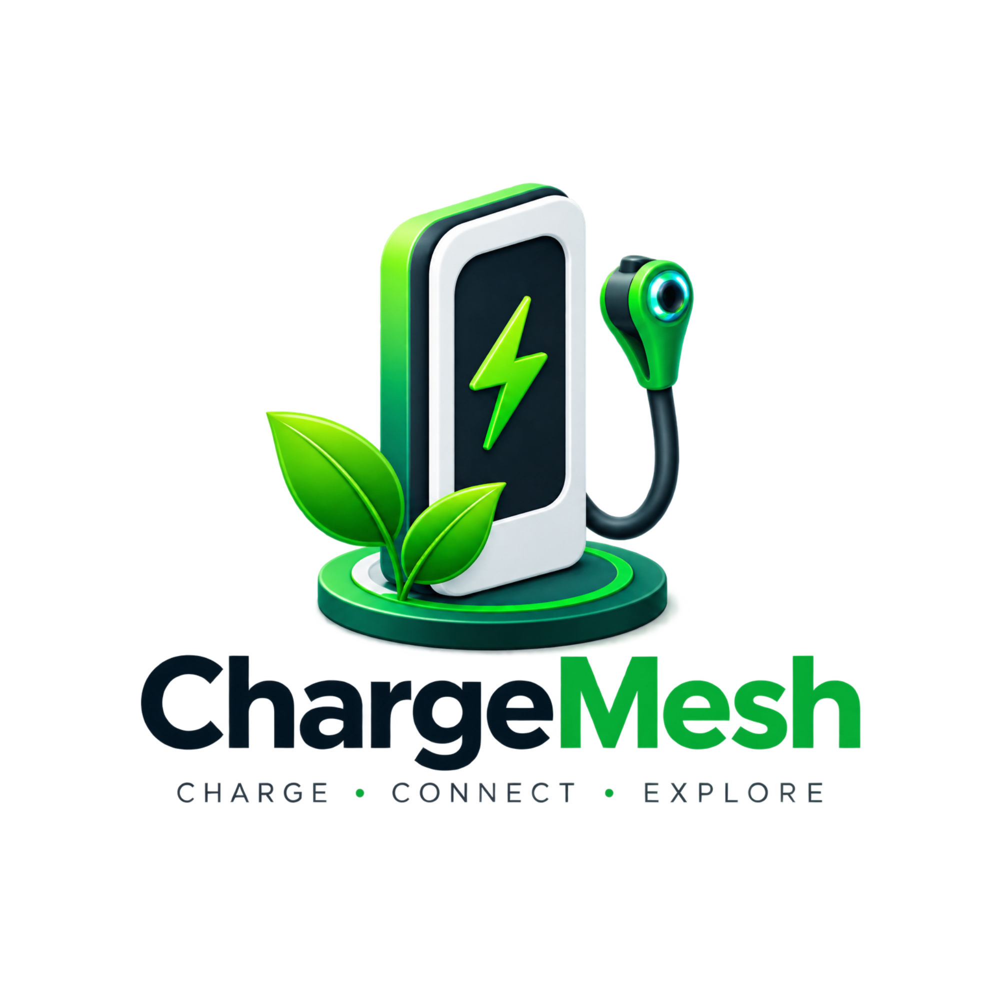
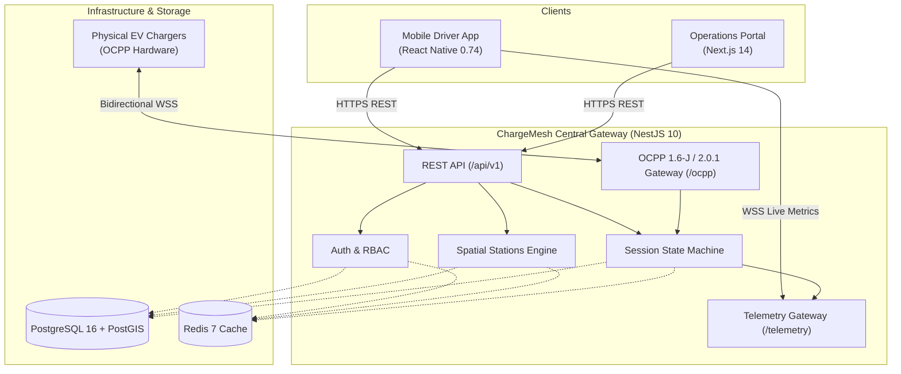

<p align="center">
  
</p>

<h1 align="center">ChargeMesh ⚡</h1>

<p align="center">
  <strong>Open-Source EV Charging Interoperability & CSMS Gateway Platform</strong><br>
  <em>One app. Multiple networks. Verified chargers. One charging experience.</em>
</p>

<p align="center">
  <a href="#-technology-stack"></a>
  <a href="#apps-mobile"></a>
  <a href="#apps-backend"></a>
  <a href="#apps-admin"></a>
  <a href="#docker"></a>
  <a href="#-protocols--standards"></a>
  <a href="CONTRIBUTING.md"></a>
  <a href="LICENSE"></a>
</p>

---

## 📖 Table of Contents

1. [Project Overview](#-project-overview)
2. [The Problem Statement](#-the-problem-statement)
3. [The ChargeMesh Solution](#-the-charge-mesh-solution)
4. [Key Features](#-key-features)
5. [Visual Gallery & UI Catalog](#-visual-gallery--ui-catalog)
6. [Architecture Overview](#-architecture-overview)
7. [Technology Stack](#-technology-stack)
8. [Repository Monorepo Structure](#-repository-monorepo-structure)
9. [Prerequisites & System Requirements](#-prerequisites--system-requirements)
10. [Local Development Setup](#-local-development-setup)
11. [Environment Variable Configuration](#-environment-variable-configuration)
12. [Database & Infrastructure Setup](#-database--infrastructure-setup)
13. [API & WebSocket Gateway Documentation](#-api--websocket-gateway-documentation)
14. [Testing & Quality Assurance](#-testing--quality-assurance)
15. [Build Instructions](#-build-instructions)
16. [Deployment & Release Instructions](#-deployment--release-instructions)
17. [Security & Privacy Posture](#-security--privacy-posture)
18. [Contributing Guidelines](#-contributing-guidelines)
19. [Development Roadmap](#-development-roadmap)
20. [Licensing & Copyright](#-licensing--copyright)
21. [Support, Community & Contact](#-support-community--contact)

---

## ⚡ Project Overview

**ChargeMesh** is an open-source EV charging interoperability and discovery platform engineered for the Indian electric vehicle ecosystem. It resolves Charge Point Operator (CPO) network fragmentation by unifying disparate charging networks into a frictionless driver experience, backed by a high-throughput OCPP 1.6-J / 2.0.1 CSMS gateway and a centralized CPO operations management portal.

---

## 🛑 The Problem Statement

India's EV charging landscape is severely fragmented:
- **App Proliferation:** EV drivers must install 10+ different CPO apps (Tata Power, Jio-bp, Statiq, Zeon, ChargeZone, Glida, etc.) to travel intercity.
- **Phantom Availability & Ghost Chargers:** Stations frequently report as "Available" when physically broken, occupied, or unreachable, stranding drivers with low battery.
- **Fragmented Wallets:** Drivers are forced to lock up prepaid balances across multiple closed-loop CPO wallets.
- **Incompatible Standards:** Disparate communication protocols across legacy AC chargers and modern DC fast chargers result in failed charging handshakes.

---

## 💡 The ChargeMesh Solution

ChargeMesh creates an interoperable, transparent ecosystem:
1. **Unified Driver App:** A single cross-platform mobile application to discover, filter, route to, initiate, and pay for charging across any participating CPO network.
2. **Canonical Status Freshness Engine:** Strict real-time status rules: data is timestamped and categorized into Live (<120s), Recent (120-300s), or Stale (>300s). **Unknown connector status is never shown as Available.**
3. **OCPP 1.6-J & 2.0.1 Gateway:** A production-ready WebSocket Central System Management Service (CSMS) capable of communicating directly with physical EV charging hardware.
4. **Single Fast Wallet:** One unified balance with automated tax calculation (18% GST) and auditable ledger history.
5. **Multi-Tenant Operations Portal:** A Next.js 14 administrative dashboard for CPOs and fleet operators to monitor real-time charger health, tariffs, sessions, and telemetry.

---

## ✨ Key Features

### 📱 Driver Mobile Experience (`apps/mobile`)
- **22 Fully Implemented Screens:** Complete flow spanning Onboarding, Auth, Discovery, Live Charging, and Account Management.
- **Hardware-Accelerated QR Scanner:** Native Android **CameraX** with **Google ML Kit** for instantaneous barcode scanning at charging guns.
- **Hardware-Backed App Lock:** Native AndroidX **BiometricPrompt** backed by the device Trusted Execution Environment (TEE) / Keystore.
- **Live Telemetry Radial Gauge:** Real-time power (kW), State of Charge (%), voltage (V), current (A), accumulated session cost, and dynamic charging curve.
- **Smart EV Garage:** Multi-vehicle management with battery chemistry specs and automatic connector compatibility filtering (CCS2, Type 2, GB/T, Bharat AC/DC).
- **Geospatial Discovery:** MapLibre GL vector maps with pre-indexed database covering 36 Indian States and 700+ Districts.
- **Bilingual Support (i18n):** Runtime persistent language switching between English and Hindi.
- **Semantic Design Tokens:** Adaptive Dark and Light themes.

### 🔌 CSMS Backend Gateway (`apps/backend`)
- **Dual Protocol Gateways:** High-throughput HTTP REST API (`/api/v1`) plus low-latency WebSocket gateways for OCPP (`/ocpp`) and Telemetry (`/telemetry`).
- **OCPP 1.6-J / 2.0.1 Protocol Handlers:** `BootNotification`, `Heartbeat`, `StatusNotification`, `Authorize`, `StartTransaction`, `StopTransaction`, `MeterValues`, and `RemoteStart/Stop`.
- **Stateless JWT Security:** Passport JWT strategy with bcrypt password hashing and RBAC role enforcement.
- **Automated Test Harness:** 100% passing unit test suites across all core modules.

### 💻 Operations & CPO Admin Portal (`apps/admin`)
- **14 Administrative Views:** Executive Dashboard, CPO Registry, Live Station Directory, Charger Health Donut, Bookings, Sessions, Fast Wallet Adjustments, and Immutable Audit Trails.
- **Interactive MapLibre Map:** Nationwide station hub clustering and status visualization.

---

## 🖼️ Visual Gallery & UI Catalog

| Discovery & Map | Live Telemetry & Charging | Fast Wallet & Ledger |
| :---: | :---: | :---: |
|  |  |  |
| *Unified map discovery across all CPO networks* | *Real-time radial gauge (kW, %, V, A)* | *Single wallet balance with 18% GST audit* |

> 📸 **Complete Visual Documentation:** Browse the full [Screenshots & Visual Catalog](docs/screenshots/README.md) for detailed descriptions of all 22 mobile screens and 14 admin portal views.

---

## 🏛️ Architecture Overview

ChargeMesh is organized as a decoupled monorepo architecture:



Detailed architecture specifications:
- [Overall System Architecture](docs/architecture/system_architecture.md)
- [Mobile Application Architecture](docs/architecture/mobile_architecture.md)
- [Backend CSMS Architecture](docs/architecture/backend_architecture.md)
- [Database & PostGIS Schema](docs/architecture/database_architecture.md)
- [Authentication Workflow](docs/architecture/auth_workflow.md)
- [Station Discovery Workflow](docs/architecture/station_discovery_workflow.md)
- [CPO Protocol Integration](docs/architecture/cpo_integration_workflow.md)
- [End-to-End Session Data Flow](docs/architecture/data_flow.md)

---

## 💻 Technology Stack

| Domain | Technology | Version | Purpose |
| :--- | :--- | :--- | :--- |
| **Monorepo** | Node.js / npm | `>=20.0.0` / `>=10.0.0` | Workspace orchestration & package management |
| **Language** | TypeScript | `^5.5.0` | Strict static typing across all workspaces |
| **Mobile App** | React Native | `0.74.2` | Cross-platform driver app (Android & iOS) |
| **Mobile Native**| AndroidX CameraX / Biometrics | API 34 | Hardware-accelerated QR scanning & TEE App Lock |
| **Backend CSMS**| NestJS / Express | `^10.3.0` | Central gateway, REST API, and WebSocket CSMS |
| **Admin Portal**| Next.js App Router | `^14.2.0` | CPO Operations & Executive Management web portal |
| **Geospatial** | PostGIS / MapLibre GL | `16-3.4` / `^10.1` | Geospatial spatial queries (`ST_DWithin`) & vector maps |
| **Cache/State** | Redis | `7-alpine` | Ephemeral session state and rate limiting |

*Full stack breakdown:* [`TECH_STACK.md`](TECH_STACK.md)

---

## 📂 Repository Monorepo Structure

```
chargemesh-app/
├── apps/
│   ├── mobile/                 # React Native 0.74.2 Driver Application
│   │   ├── android/            # Gradle configuration, ProGuard, CameraX & Biometric bridges
│   │   └── src/                # 22 Screens, 20+ Components, 7 Contexts, i18n, Theme
│   ├── backend/                # NestJS 10.3 REST API & OCPP CSMS Gateway
│   │   ├── src/                # Auth, Stations, Sessions, Telemetry, OCPP, Admin modules
│   │   └── test/               # Automated Jest unit test suites (12 tests)
│   └── admin/                  # Next.js 14.2 Operations & CPO Admin Web Portal
│       └── src/                # 14 Management Views, MapLibre & data services
├── packages/
│   ├── shared-types/           # Canonical TypeScript interfaces & enums
│   ├── shared-constants/       # Business constants, error codes, tax rates, timeouts
│   └── tsconfig/               # Shared base TypeScript compiler options
├── docker/
│   └── postgres/               # PostgreSQL PostGIS initialization script (init.sql)
├── docs/                       # Comprehensive documentation suite (25+ files)
│   ├── architecture/           # 8 Canonical Mermaid architecture diagrams
│   └── screenshots/            # Verified visual assets & UI catalog
└── .github/                    # CI/CD workflows, issue templates & PR template
```

---

## 🛠️ Prerequisites & System Requirements

- **Node.js:** `>= 20.0.0` (LTS)
- **npm:** `>= 10.0.0`
- **Docker & Docker Compose:** Required for PostgreSQL + PostGIS & Redis
- **Android Studio (for mobile development):**
  - JDK 17 (Eclipse Temurin recommended)
  - Android SDK Platform 34 (Android 14)
  - Android SDK Build-Tools 34.0.0

---

## 🚀 Local Development Setup

### 1. Clone & Install Dependencies
```bash
git clone https://github.com/abhayksingh614/chargemesh-app.git
cd chargemesh-app
npm install
```

### 2. Build Shared Monorepo Packages
```bash
npm run build --workspace=packages/shared-types
npm run build --workspace=packages/shared-constants
```

### 3. Verify Static Type Safety
```bash
npm run typecheck
```

### 4. Start Local Infrastructure Containers
```bash
npm run docker:up
```
*Spins up PostgreSQL 16 (PostGIS) on port 5432 and Redis 7 on port 6379.*

### 5. Launch Applications
- **Backend CSMS Server:**
  ```bash
  npm run dev:backend
  ```
  *Server starts on `http://localhost:3001` with WebSocket gateways at `ws://localhost:3001/ocpp` and `ws://localhost:3001/telemetry`.*
- **Admin Operations Portal:**
  ```bash
  npm run dev:admin
  ```
  *Accessible at `http://localhost:3000` (or 3001).*
- **Mobile Driver App:**
  ```bash
  # Terminal 1: Start Metro bundler
  npm run dev:mobile

  # Terminal 2: Install on connected Android device / emulator
  npm run android --workspace=apps/mobile
  ```

---

## 🔐 Environment Variable Configuration

Copy the template environment file:
```bash
cp .env.example .env
```
Key configuration parameters:
- `DB_HOST`, `DB_PORT`, `DB_NAME`, `DB_USER`, `DB_PASSWORD`: PostgreSQL connection
- `REDIS_HOST`, `REDIS_PORT`: Redis cache connection
- `JWT_SECRET`, `JWT_EXPIRES_IN`: Authentication token signing
- `CPO_START_COMMAND_TIMEOUT_MS`: Timeout for remote start commands (default: `30000`)
- `CPO_STATUS_STALE_THRESHOLD_SECONDS`: Threshold for marking status stale (default: `300`)

> ⚠️ **Security Notice:** Never commit `.env` files. In production, use AWS Secrets Manager or HashiCorp Vault.

---

## 🗄️ Database & Infrastructure Setup

ChargeMesh utilizes Docker Compose for local development:
```bash
# Start PostgreSQL (PostGIS) and Redis
npm run docker:up

# Start with developer GUI tools (pgAdmin on :5050 and Redis Commander on :8081)
npm run docker:tools

# Stop containers
npm run docker:down
```

Database initialization is automated via `docker/postgres/init.sql`, enabling:
- `postgis` & `postgis_topology` for geospatial computations
- `uuid-ossp` for RFC 4122 UUID generation
- `pg_trgm` for high-speed fuzzy text matching on stations and addresses

---

## 📡 API & WebSocket Gateway Documentation

| Protocol | Endpoint | Description |
| :--- | :--- | :--- |
| `POST` | `/api/v1/auth/register` | Driver registration with vehicle details |
| `POST` | `/api/v1/auth/login` | Driver authentication; returns JWT Bearer token |
| `GET` | `/api/v1/auth/me` | Authenticated driver profile retrieval |
| `GET` | `/api/v1/stations` | Spatial search with `lat`, `lng`, `radiusKm`, `connectorType` |
| `GET` | `/api/v1/stations/:id` | Full station details and live connector status |
| `POST` | `/api/v1/sessions/start` | Remote start session on target charger |
| `POST` | `/api/v1/sessions/:id/stop` | Remote stop charging session |
| `WSS` | `/ocpp` | Bidirectional OCPP 1.6-J / 2.0.1 CSMS gateway |
| `WSS` | `/telemetry` | Real-time session telemetry broadcast stream |

*Complete API Schema:* [`docs/API_DOCUMENTATION.md`](docs/API_DOCUMENTATION.md)

---

## 🧪 Testing & Quality Assurance

```bash
# Run full monorepo typecheck (0 errors across 5 workspaces)
npm run typecheck

# Run backend unit test suites (12 passing tests)
npm run test:backend

# Run with coverage report
npm run test:cov --workspace=apps/backend
```

*Testing specifications and guidelines:* [`TESTING.md`](TESTING.md)

---

## 📦 Build Instructions

### 1. Build Backend Gateway
```bash
npm run build:backend
```
*Outputs to `apps/backend/dist`.*

### 2. Build Android Production App Bundle (`.aab`)
```bash
cd apps/mobile/android
./gradlew clean bundleRelease
```
*Outputs to `apps/mobile/android/app/build/outputs/bundle/release/app-release.aab`.*

---

## 🚢 Deployment & Release Instructions

- **Google Play Store:** Consult [`docs/PLAY_STORE_RELEASE_READINESS.md`](docs/PLAY_STORE_RELEASE_READINESS.md) for production signing, Android 14 requirements, ProGuard keep rules, and store listing assets.
- **Docker Production Container:** Build images using the multi-stage Dockerfiles specified in [`docs/DEPLOYMENT.md`](docs/DEPLOYMENT.md).

---

## 🛡️ Security & Privacy Posture

- **Responsible Disclosure:** If you find a security vulnerability, please email **security@chargemesh.in** directly. Do NOT create public GitHub issues. See [`SECURITY.md`](SECURITY.md).
- **Zero Secrets Committed:** Automated scanning verifies no credentials, API keys, or private keys exist in version control.
- **Data Protection:** Implements data minimization and consent standards compliant with India's **Digital Personal Data Protection (DPDP) Act 2023**.

---

## 🤝 Contributing Guidelines

We welcome community pull requests, bug reports, and protocol contributions!
1. Read the [Code of Conduct](CODE_OF_CONDUCT.md).
2. Follow our [Contribution Guidelines](CONTRIBUTING.md).
3. Review our [Git Branching Strategy](.github/GIT_STRATEGY.md) (All PRs must target `develop`).
4. Follow Conventional Commits format (`feat:`, `fix:`, `docs:`).

---

## 🗺️ Development Roadmap

ChargeMesh development is organized into 5 clear phases:
- **Phase 1: Foundation & Architecture Hardening** *(Complete)*
- **Phase 2: Core Platform & Integration** *(In Progress — Mobile REST Wiring)*
- **Phase 3: EV Interoperability & CPO Protocols** *(In Progress — OCPP active; OCPI planned)*
- **Phase 4: Platform Expansion & Operations** *(Scaffolded — Next.js Admin active)*
- **Phase 5: Open-Source Community Ecosystem** *(Active)*

*Track detailed milestones:* [`ROADMAP.md`](ROADMAP.md)

---

## 📄 Licensing & Copyright

- **Copyright:** Copyright (c) 2026 Abhay Kumar Singh and ChargeMesh Contributors. See [`COPYRIGHT.md`](COPYRIGHT.md).
- **Open-Source Evaluation:** The maintainers recommend the **MIT License** for broad community adoption. See [`docs/LICENSE_EVALUATION.md`](docs/LICENSE_EVALUATION.md) and [`THIRD_PARTY_NOTICES.md`](THIRD_PARTY_NOTICES.md).

---

## 💬 Support, Community & Contact

- **GitHub Discussions:** [Ask questions and share ideas](https://github.com/abhayksingh614/chargemesh-app/discussions)
- **Issue Tracker:** [Report bugs or request features](https://github.com/abhayksingh614/chargemesh-app/issues)
- **Project Maintainer:** Abhay Kumar Singh ([@abhayksingh614](https://github.com/abhayksingh614))
- **Email:** [support@chargemesh.in](mailto:support@chargemesh.in)
