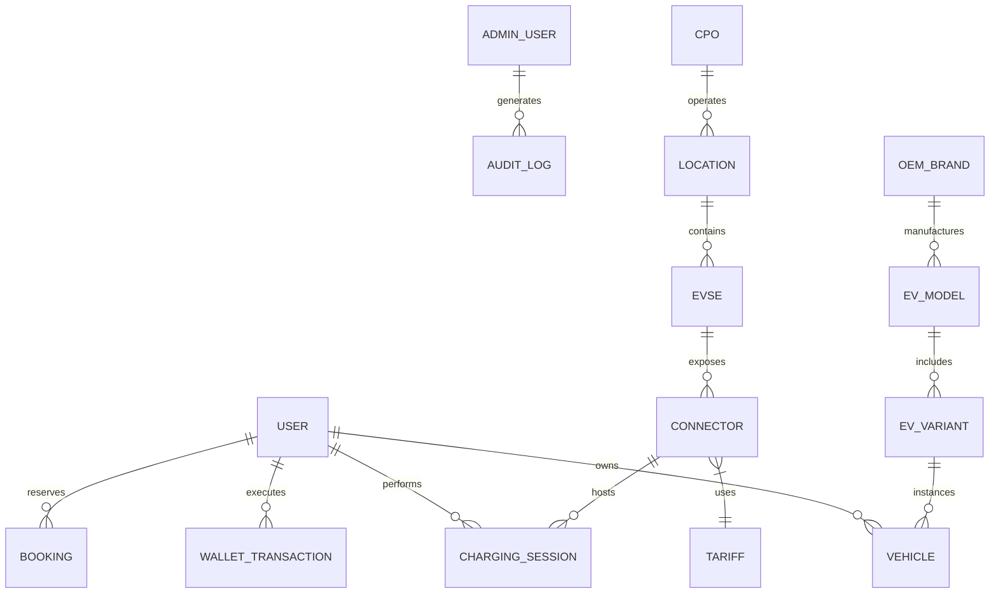

# ChargeMesh Admin Dashboard — Data Models & Schema Specification

This document defines the data models, relations, and entity extensions utilized by the ChargeMesh Admin Dashboard. All contracts build upon the canonical definitions in `@chargemesh/shared-types`.

---

## 1. Relational Entity Relationship Diagram



---

## 2. Entity Model Definitions

### 2.1 Admin User & Authentication Models

```typescript
export enum AdminRole {
  SUPER_ADMIN = 'SUPER_ADMIN',
  OPERATIONS_ADMIN = 'OPERATIONS_ADMIN',
  FINANCE_ADMIN = 'FINANCE_ADMIN',
  SUPPORT_ADMIN = 'SUPPORT_ADMIN',
  ANALYST = 'ANALYST',
}

export enum AdminStatus {
  ACTIVE = 'ACTIVE',
  SUSPENDED = 'SUSPENDED',
  INACTIVE = 'INACTIVE',
}

export interface AdminUser {
  id: string;
  email: string;
  name: string;
  role: AdminRole;
  status: AdminStatus;
  department?: string;
  lastLoginAt?: string;
  createdAt: string;
  updatedAt: string;
}
```

### 2.2 Audit Log Model

```typescript
export enum AuditActionType {
  USER_SUSPEND = 'USER_SUSPEND',
  USER_REACTIVATE = 'USER_REACTIVATE',
  WALLET_ADJUSTMENT = 'WALLET_ADJUSTMENT',
  PAYMENT_REFUND = 'PAYMENT_REFUND',
  CPO_UPDATE = 'CPO_UPDATE',
  STATION_CREATE = 'STATION_CREATE',
  STATION_UPDATE = 'STATION_UPDATE',
  REMOTE_COMMAND_EXECUTE = 'REMOTE_COMMAND_EXECUTE',
  EV_MASTER_UPDATE = 'EV_MASTER_UPDATE',
  BROADCAST_CREATE = 'BROADCAST_CREATE',
}

export interface AuditLogEntry {
  id: string;
  actorId: string;
  actorName: string;
  actorRole: AdminRole;
  action: AuditActionType;
  targetEntity: 'USER' | 'WALLET' | 'PAYMENT' | 'CPO' | 'STATION' | 'CHARGER' | 'EV_MASTER' | 'BROADCAST';
  targetId: string;
  previousValue?: Record<string, any>;
  newValue?: Record<string, any>;
  reason: string;
  ipAddress: string;
  userAgent?: string;
  timestamp: string;
}
```

### 2.3 Extended CPO Management Model

```typescript
export interface AdminCpoDetail extends Cpo {
  apiEndpointUrl?: string;
  apiKeyMasked?: string;
  syncFrequencySeconds: number;
  totalStationCount: number;
  totalOnlineChargers: number;
  totalSessionsLifetime: number;
  revenueSharePercent: number;
  uptimePercent30d: number;
  lastSyncResult?: {
    status: 'SUCCESS' | 'PARTIAL' | 'FAILED';
    locationsSynced: number;
    tariffsSynced: number;
    errorCount: number;
    timestamp: string;
  };
}
```

### 2.4 Centralized EV Master Model

```typescript
export interface OemBrand {
  id: string;
  name: string;
  logoEmoji: string;
  country: string;
  modelCount: number;
  models: EvModelMaster[];
}

export interface EvModelMaster {
  id: string;
  brandId: string;
  name: string;
  bodyType: 'SUV' | 'SEDAN' | 'HATCHBACK' | 'CROSSOVER' | 'VAN';
  variants: EvVariantMaster[];
}

export interface EvVariantMaster {
  id: string;
  modelId: string;
  name: string;
  batteryCapacityKwh: number;
  maxDcPowerKw: number;
  maxAcPowerKw: number;
  rangeKm: number;
  connectorTypes: ConnectorType[];
  releaseYear?: number;
  isVerified: boolean;
}
```
