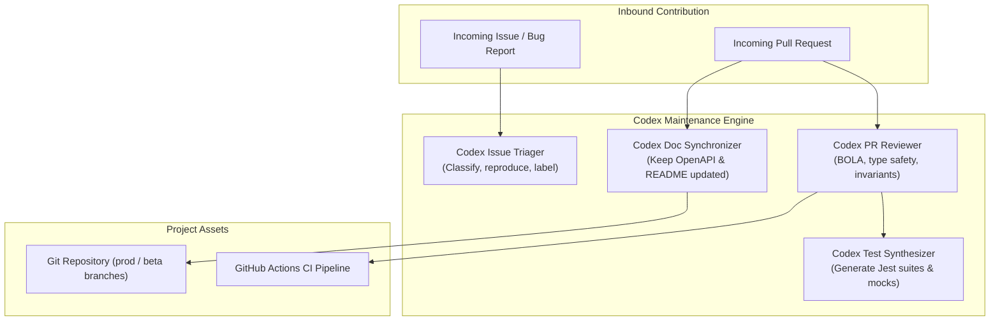

# OpenAI Codex Integration Strategy for Open-Source Maintenance

**Project:** ChargeMesh  
**Target Program:** [OpenAI Codex for Open Source Program](https://developers.openai.com/community/codex-for-oss)  
**Objective:** Operationalize OpenAI Codex & API Credits for Open-Source Maintenance  

---

## 1. Executive Summary

As an ambitious open-source platform maintaining three interconnected applications (NestJS backend, React Native mobile, Next.js admin portal) and two shared libraries, our primary maintenance challenge is maintaining high software quality, security, and protocol compliance across rapid contributor cycles.

This strategy outlines how ChargeMesh will utilize **ChatGPT Pro with Codex** and the **Codex Open Source Fund API credits** to automate maintenance workflows, enforce security invariants, generate edge-case tests, and assist community contributors.

---

## 2. Core Maintenance Workflows Powered by Codex



### 2.1 Automated Pull Request Code Review
- **Function:** Run an automated GitHub Actions step powered by Codex on every pull request from community contributors.
- **Enforcement Rules:**
  - Verify that no implicit `any` types or unvalidated query parameters are introduced.
  - Check for Broken Object Level Authorization (BOLA) in controller endpoints.
  - Verify compliance with ChargeMesh domain invariants (e.g. unknown connector status must never be rendered as available; statuses older than 300s must trigger stale warning).
- **Outcome:** Rapid, constructive feedback to open-source contributors within minutes of submitting a PR.

### 2.2 Security & Financial Invariant Audit
- **Function:** Deep code reasoning applied to financial ledger and charging session state machines.
- **Focus Areas:**
  - Audit database transactions for pessimistic locking (`SELECT ... FOR UPDATE`) in `WalletService`.
  - Validate HMAC-SHA256 signature verification in payment webhooks.
  - Inspect OCPP WebSocket message decoders for denial-of-service or memory leak risks during heavy telemetry frames.

### 2.3 Automated Test Case Synthesis
- **Function:** Utilize Codex API credits to generate comprehensive unit and property-based test cases for newly added services and controllers.
- **Specific Applications:**
  - Generate adversarial tests for OCPP 1.6-J and 2.0.1 edge-case message frames.
  - Generate negative test matrices for invalid input payloads, malformed UUIDs, and boundary conditions.
  - Synthesize realistic mock data for Indian metro charging station distributions.

### 2.4 Documentation & API Schema Synchronization
- **Function:** Monitor changes in NestJS controllers and DTOs and automatically generate pull requests updating [API_DOCUMENTATION.md](file:///c:/Users/aksde/Videos/My_Codex/Chargemesh_app/API_DOCUMENTATION.md) and OpenAPI JSON specs.
- **Outcome:** Eliminates documentation drift, ensuring API docs always reflect actual code.

### 2.5 Issue Triage & Reproduction Assistance
- **Function:** Automatically analyze user-submitted bug reports, check for required reproduction information (device model, Android OS version, charger protocol), and request missing context.
- **Outcome:** Reduces maintainer triage fatigue and accelerates time-to-resolution for community bug reports.

---

## 3. Allocation Plan for OpenAI API Credits

If awarded API credits under the Codex Open Source Fund, credits will be allocated strictly to automated open-source infrastructure:

| Maintenance Domain | Estimated Credit Allocation (%) | Target Activity | Expected Maintenance Impact |
| :--- | :---: | :--- | :--- |
| **Automated PR Reviews** | **35%** | GitHub Actions bot analyzing community PR diffs for BOLA, type safety, and domain invariants | Reduces maintainer PR review turnaround from 3 days to under 15 minutes |
| **Automated Test Generation** | **30%** | Synthesizing Jest test suites for uncovered controller branches and OCPP message handlers | Increases monorepo test coverage towards 95% |
| **Security & Vulnerability Audits** | **20%** | Deep semantic scanning of authentication, token handling, and wallet ledger updates | Prevents financial double-spend and session hijacking exploits |
| **Doc & Schema Sync** | **15%** | Generating API updates, changelogs, and release summaries from commit logs | Eliminates documentation drift across releases |

---

## 4. Implementation Architecture for GitHub Actions

```yaml
# Conceptual workflow: .github/workflows/codex-pr-review.yml
name: Codex Automated PR Review
on:
  pull_request:
    types: [opened, synchronize]

jobs:
  codex-review:
    runs-on: ubuntu-latest
    steps:
      - uses: actions/checkout@v4
        with:
          fetch-depth: 0
      - name: Run Codex Review Bot
        env:
          OPENAI_API_KEY: ${{ secrets.OPENAI_CODEX_API_KEY }}
        run: |
          node scripts/codex-review-runner.js --pr-diff
```

---

## 5. Summary of Benefits to the Open-Source Community

Integrating OpenAI Codex into ChargeMesh will allow our small core team to maintain the software quality, security standards, and release velocity of a much larger engineering organization. This directly benefits Indian EV drivers, CPO operators, and open-source contributors by providing a battle-tested, secure, and documented roaming infrastructure platform.
