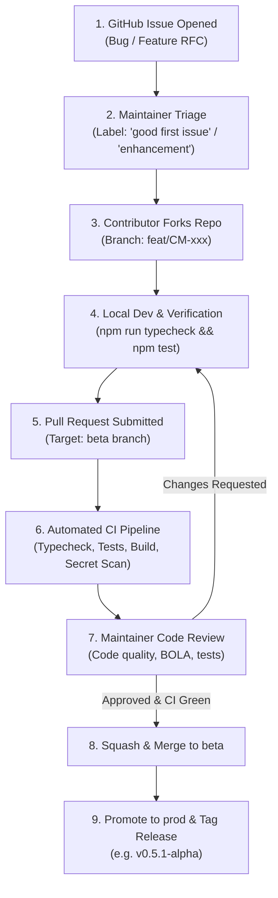

# Open-Source Governance, Community & Maintenance Model

**Audit Date:** November 21, 2026  
**Project:** ChargeMesh  
**Target:** OpenAI Codex for Open Source Program  
**Governance Model:** Benevolent Dictator / Core Maintainer with Open Community Stewardship  

---

## 1. Governance Principles & Philosophy

ChargeMesh is an open-source, community-driven platform designed to accelerate EV adoption and charging interoperability across India. Our governance framework is built on four core tenets:
1. **Transparency:** Architectural decisions, protocol RFCs, and release roadmaps are documented publicly.
2. **Quality & Discipline:** All contributions must satisfy strict static typing, unit testing, and security criteria before merge.
3. **Inclusivity & Respect:** Contributors of all backgrounds are welcomed under the Contributor Covenant v2.1 code of conduct.
4. **Safety & Zero-Trust:** Driver privacy, physical charger safety, and financial ledger integrity take precedence over feature velocity.

---

## 2. Governance Documents Inventory

| Document | File Path | Scope & Function |
| :--- | :--- | :--- |
| **Code of Conduct** | [CODE_OF_CONDUCT.md](file:///c:/Users/aksde/Videos/My_Codex/Chargemesh_app/CODE_OF_CONDUCT.md) | Community standards based on Contributor Covenant v2.1 |
| **Contribution Guidelines** | [CONTRIBUTING.md](file:///c:/Users/aksde/Videos/My_Codex/Chargemesh_app/CONTRIBUTING.md) | Step-by-step developer guide, branching model, commit conventions |
| **Open-Source License** | [LICENSE](file:///c:/Users/aksde/Videos/My_Codex/Chargemesh_app/LICENSE) | Apache License 2.0 terms granting community usage and patent protection |
| **Security Policy** | [SECURITY.md](file:///c:/Users/aksde/Videos/My_Codex/Chargemesh_app/SECURITY.md) | Vulnerability disclosure SLAs, response timelines, safe contact aliases |
| **Changelog** | [CHANGELOG.md](file:///c:/Users/aksde/Videos/My_Codex/Chargemesh_app/CHANGELOG.md) | Semantic versioning changelog (`v0.5.1-alpha`) |
| **Git Strategy** | [.github/GIT_STRATEGY.md](file:///c:/Users/aksde/Videos/My_Codex/Chargemesh_app/.github/GIT_STRATEGY.md) | Two-tier branch structure (`beta` and `prod`) |
| **Pull Request Template** | [.github/pull_request_template.md](file:///c:/Users/aksde/Videos/My_Codex/Chargemesh_app/.github/pull_request_template.md) | Standardized PR checklist and domain rule verification |
| **Bug Report Template** | [.github/ISSUE_TEMPLATE/bug_report.yml](file:///c:/Users/aksde/Videos/My_Codex/Chargemesh_app/.github/ISSUE_TEMPLATE/bug_report.yml) | Structured YAML bug submission schema |
| **Feature Request Template** | [.github/ISSUE_TEMPLATE/feature_request.yml](file:///c:/Users/aksde/Videos/My_Codex/Chargemesh_app/.github/ISSUE_TEMPLATE/feature_request.yml) | Architecture-aligned feature proposal schema |
| **Documentation Issue Template** | [.github/ISSUE_TEMPLATE/documentation_issue.yml](file:///c:/Users/aksde/Videos/My_Codex/Chargemesh_app/.github/ISSUE_TEMPLATE/documentation_issue.yml) | Schema for reporting documentation fixes |

---

## 3. Contribution & Review Lifecycle

### 3.1 Pull Request Requirements
Every pull request submitted to ChargeMesh must satisfy:
1. **Branch Target:** All feature branches target `beta` (never direct to `prod`).
2. **Typecheck & Tests:** Must pass `npm run typecheck` and `npm run test` with zero failures.
3. **Domain Status Invariants:**
   - Unknown connector status (`UNKNOWN`) must never be rendered as available.
   - Status updates older than 300 seconds must render a `STALE` freshness warning.
4. **Secret Hygiene:** PRs must not introduce credentials or `.env` files.
5. **Conventional Commits:** Commit messages follow `feat:`, `fix:`, `docs:`, `test:`, `chore:`.

---

## 4. Release Management & Versioning

- ChargeMesh follows **Semantic Versioning 2.0.0** (`MAJOR.MINOR.PATCH[-PRERELEASE]`):
  - `MAJOR`: Incompatible API changes, breaking database migrations.
  - `MINOR`: New backwards-compatible features, new OCPP RPC handlers.
  - `PATCH`: Backwards-compatible bug fixes, security patches.
  - Current version: **`v0.5.1-alpha`**.
- Releases are tagged in Git (`git tag -a v0.5.1-alpha -m "..."`) and accompanied by release notes in [CHANGELOG.md](file:///c:/Users/aksde/Videos/My_Codex/Chargemesh_app/CHANGELOG.md).

---

## 5. Community Roles & Responsibilities

- **Primary Maintainer:** Sets architectural direction, oversees release tags, reviews security advisories, and holds final merge authority.
- **Core Maintainers / Reviewers:** Review pull requests, triage bug reports, maintain CI/CD workflows, and ensure documentation accuracy.
- **Contributors:** Submit bug reports, author PRs, improve test coverage, translate documentation, and propose protocol enhancements.
