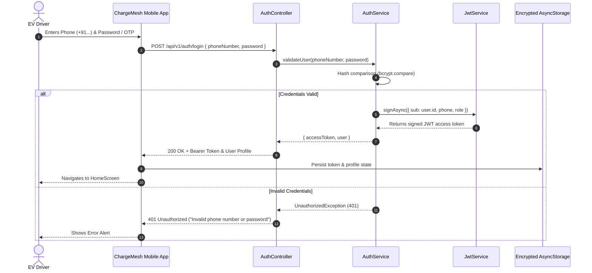
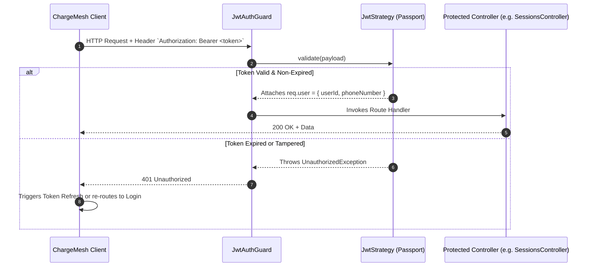
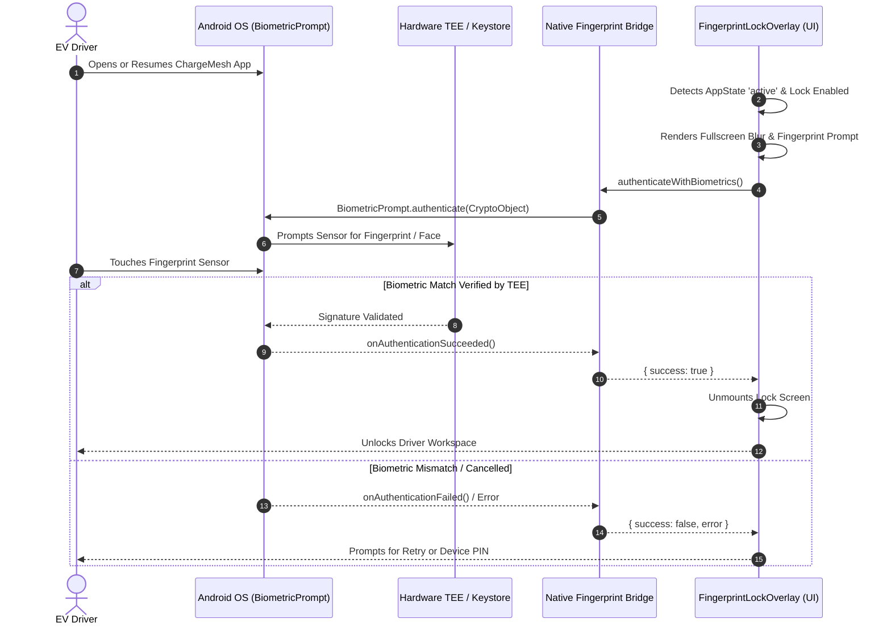

# Authentication & Security Workflow

> **Component:** Authentication & Device Authorization  
> **Source:** `apps/backend/src/modules/auth`, `apps/mobile/src/services/fingerprintAuth.ts`, `apps/mobile/src/context/AuthContext.tsx`  

This document details both the API authentication pipeline and the mobile hardware-backed biometric security flow.

---

## 1. Driver Authentication & JWT Token Issuance

---

## 2. Protected Request Authorization Pipeline

---

## 3. Mobile Hardware Biometric Security Flow

