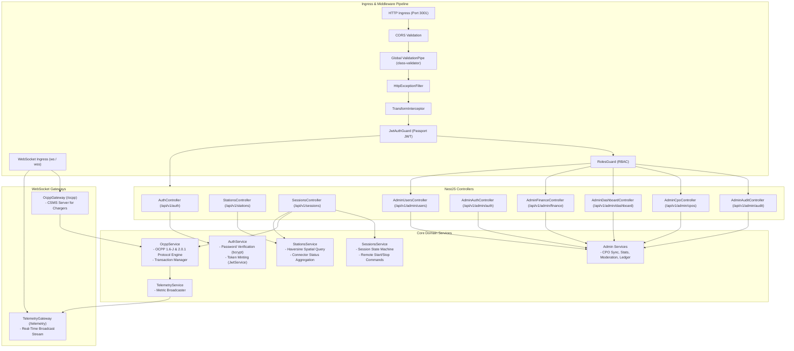

# Backend Platform Architecture

> **Component:** `apps/backend`  
> **Source:** NestJS 10.3 Gateway Architecture  

This diagram documents the modular architecture of the ChargeMesh backend gateway, mapping HTTP REST controllers, WebSocket gateways, dependency-injected services, and request pipelines.

