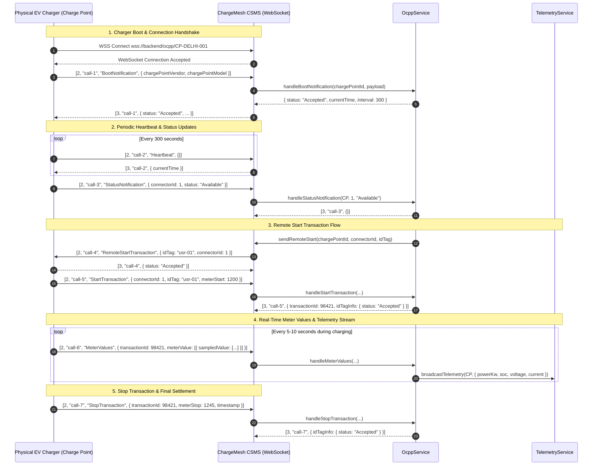
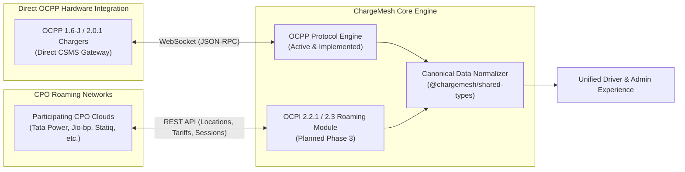

# Charge Point Operator (CPO) Integration Workflow

> **Component:** CPO Gateway & Protocol Interoperability  
> **Source:** `apps/backend/src/modules/ocpp` & `docs/CPO_AND_STATIONS.md`  

This document describes how ChargeMesh interfaces with third-party Charge Point Operators and hardware charging equipment via OCPP 1.6-J / 2.0.1 and roaming interfaces.

---

## 1. OCPP 1.6-J / 2.0.1 Direct CSMS Protocol Workflow

---

## 2. Protocol Interoperability Model

ChargeMesh is designed to support two complementary CPO integration models:

