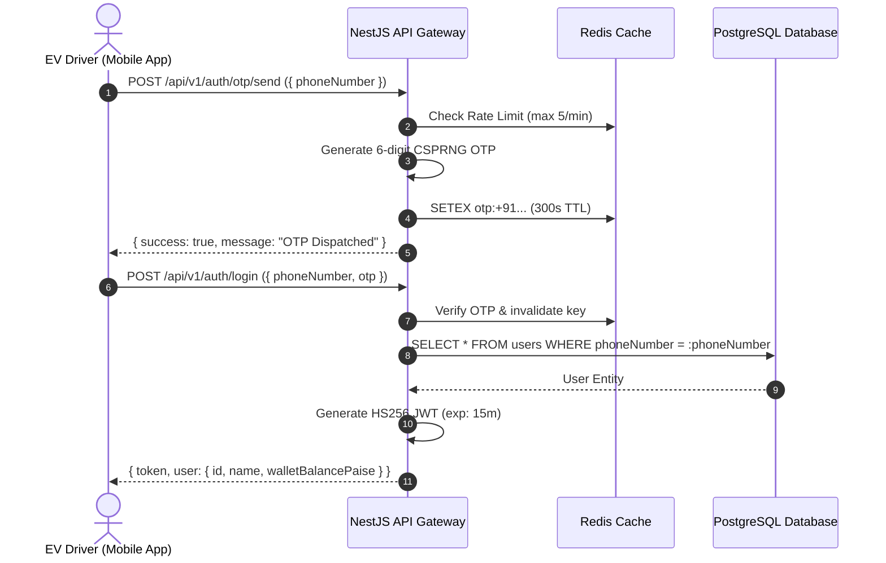
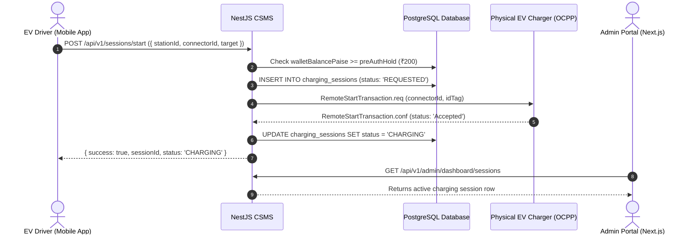
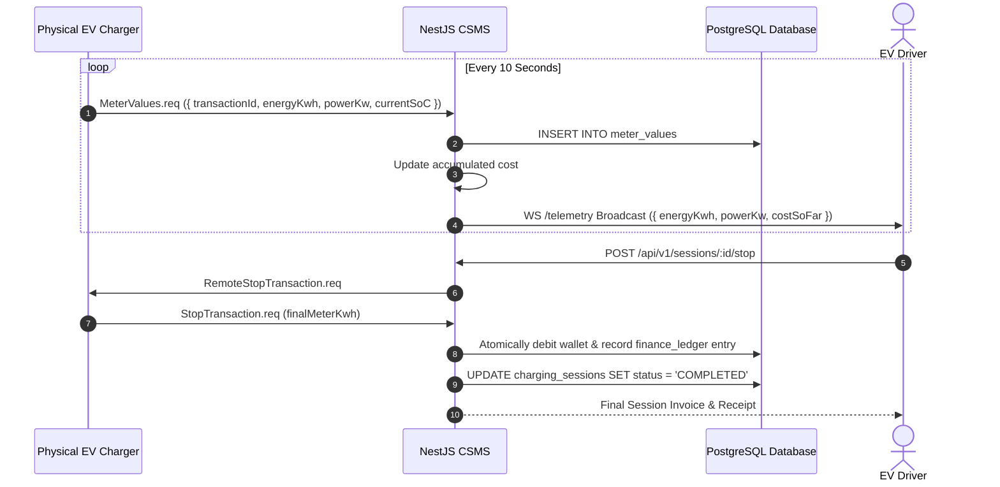

# ChargeMesh — End-to-End Data Flow Specification

This document details the exact sequence of messages and state transitions across the platform.

---

## 1. Driver Authentication & Profile Hydration

---

## 2. Charging Session Initiation & OCPP RemoteStart

---

## 3. Telemetry Ingestion & Financial Settlement

