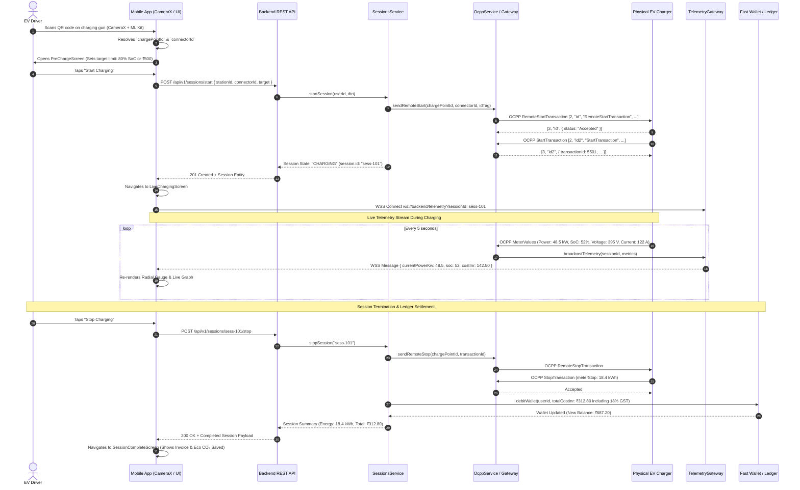

# End-to-End Data Flow Architecture

> **Component:** End-to-End System Data Flow  
> **Source:** Mobile Client, Backend REST & OCPP Gateways, Telemetry Broadcaster  

This diagram traces the complete lifecycle of an EV charging session, from QR scan at the physical charger to live telemetry rendering and final financial ledger debit.

---

## 1. End-to-End Session Data Flow

