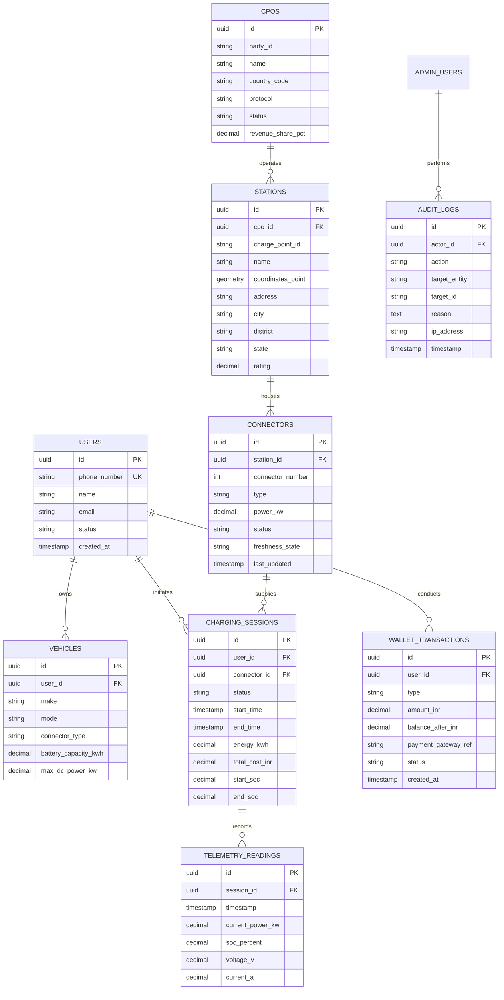

# Database & Geospatial Architecture

> **Component:** Data Persistence & Caching  
> **Source:** `docker-compose.yml`, `docker/postgres/init.sql`, and Canonical Domain Models (`@chargemesh/shared-types`)  

This document details the relational data model, geospatial indexing strategy, and caching layer designed for ChargeMesh.

> [!NOTE]
> **Implementation Status:** The Docker PostgreSQL 16 + PostGIS environment is active and configured via `init.sql`. The current backend development phase utilizes in-memory map repositories that conform strictly to these relational entities. Production database migration scripts (TypeORM/Prisma) are planned.

---

## 1. Entity-Relationship Model (PostgreSQL)



---

## 2. Geospatial Query Pipeline (PostGIS)

Charging station discovery relies on PostGIS spatial functions:

1. **Point Definition:** Coordinates are stored as `GEOMETRY(Point, 4326)` representing `(longitude, latitude)`.
2. **Radial Search (`ST_DWithin`):** Station discovery calculates proximity against driver coordinates:
   ```sql
   SELECT id, name, ST_Distance(coordinates_point, ST_MakePoint(?, ?)::geography) AS distance_meters
   FROM stations
   WHERE ST_DWithin(coordinates_point, ST_MakePoint(?, ?)::geography, ?);
   ```
3. **Spatial Index:** PostGIS `GIST (coordinates_point)` ensures sub-millisecond bounding-box filtering across thousands of nationwide chargers.
4. **Fuzzy Search Index:** `pg_trgm` extension enables trigram GIN indexes on station names, district names, and addresses for instant typeahead search.

---

## 3. Ephemeral State & Caching Architecture (Redis 7)

Redis provides low-latency key-value operations:
- **Connector State Cache:** Key `cpo:{cpoId}:station:{stationId}:connector:{connectorId}:status` (TTL 300s).
- **Session Rate Limiter:** Key `ratelimit:{userId}:{endpoint}`.
- **WebSocket Socket Mapping:** Tracks connected charger sockets by `chargePointId` to active node instances.
