# Mobile Application Architecture

> **Component:** `apps/mobile`  
> **Source:** React Native 0.74.2 Codebase  

This diagram details the client architecture of the ChargeMesh driver app, including screen routing, context state providers, native hardware bridges, and persistent storage.

```mermaid
flowchart TD
    subgraph UI["UI & Navigation Layer"]
        RootStack["RootStackNavigator (Native Stack)"]
        MainTabs["MainTabNavigator (Bottom Tabs)"]
        
        subgraph Tabs["Bottom Navigator Tabs"]
            HomeTab["HomeScreen"]
            MapTab["MapScreen (MapLibre GL)"]
            QRTab["QRScannerScreen (CameraX)"]
            ActivityTab["ActivityScreen"]
            ProfileTab["ProfileScreen"]
        end

        subgraph KeyFlowScreens["Session & Driver Flows"]
            Splash["SplashScreen"]
            Onboard["OnboardingScreen"]
            AuthScreens["LoginScreen / RegisterScreen"]
            StationDetail["StationDetailScreen"]
            PreCharge["PreChargeScreen"]
            LiveCharge["LiveChargingScreen (Gauge UI)"]
            Complete["SessionCompleteScreen"]
            Vehicles["MyVehiclesScreen / AddVehicleScreen"]
            WalletScreens["WalletTransactionsScreen / AddMoneyScreen"]
            Eco["EcoSustainabilityScreen"]
        end
    end

    subgraph State["State Management (React Contexts)"]
        AuthCtx["AuthContext (JWT & Driver Profile)"]
        ChargingCtx["ChargingContext (Live Session Metrics)"]
        FilterCtx["FilterContext (Connectors, Power, Status)"]
        FavoritesCtx["FavoritesContext (Bookmarked Stations)"]
        ThemeCtx["ThemeContext (Dark / Light Semantic Tokens)"]
        LangCtx["LanguageContext (EN / HI Bilingual Strings)"]
    end

    subgraph Hardware["Native Hardware Bridges"]
        CamX["AndroidX CameraX + Google ML Kit Bridge"]
        Biometrics["AndroidX BiometricPrompt + TEE Keystore"]
    end

    subgraph Storage["Data & Local Persistence"]
        MockData["Local Data Layer (mockData.ts)"]
        EVCatalog["EV Models Catalog (evCatalog.json)"]
        GeoMaster["State/District Master (stateDistrictMaster.json)"]
        AsyncStore[("AsyncStorage (Token, Cache, Settings)")]
    end

    RootStack --> Splash
    RootStack --> Onboard
    RootStack --> AuthScreens
    RootStack --> MainTabs
    RootStack --> StationDetail
    RootStack --> PreCharge
    RootStack --> LiveCharge
    RootStack --> Complete

    MainTabs --> HomeTab
    MainTabs --> MapTab
    MainTabs --> QRTab
    MainTabs --> ActivityTab
    MainTabs --> ProfileTab

    QRTab --> CamX
    Splash --> Biometrics
    
    HomeTab & MapTab & StationDetail --> State
    PreCharge & LiveCharge --> ChargingCtx

    State --> AsyncStore
    State --> MockData
    FilterCtx --> EVCatalog
    MapTab --> GeoMaster
```

