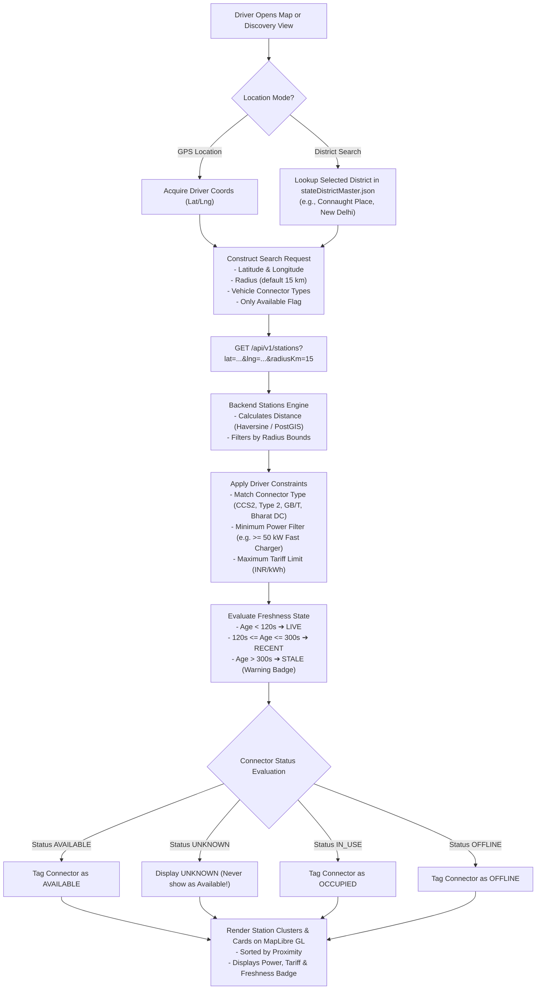

# EV Charging Station Discovery Workflow

> **Component:** Geospatial Search & Connector Status Aggregator  
> **Source:** `apps/backend/src/modules/stations`, `apps/mobile/src/context/FilterContext.tsx`, `apps/mobile/src/screens/MapScreen.tsx`  

This document illustrates the station discovery workflow, from GPS coordinate acquisition to multi-criteria filtering and status freshness validation.

---

## 1. Discovery Pipeline Flowchart

---

## 2. Canonical Status Freshness Matrix

ChargeMesh enforces strict reliability rules to prevent "phantom availability":

| Status | Age Condition | UI Representation | Booking Allowed |
| :--- | :--- | :--- | :--- |
| **AVAILABLE (LIVE)** | Age < 120 seconds | 🟢 Green Badge ("Available") | Yes |
| **AVAILABLE (RECENT)** | 120s ≤ Age ≤ 300s | 🟡 Amber-Green Badge ("Updated 3m ago") | Yes |
| **AVAILABLE (STALE)** | Age > 300 seconds | ⚠️ Orange Warning ("Stale Data — Verify On Site") | Conditional Warning |
| **IN_USE / OCCUPIED** | Real-time | 🔵 Blue Badge ("In Use — Charging") | No |
| **UNKNOWN** | No recent heartbeat | ⚪ Grey Badge ("Status Unknown") | **Blocked (Never assume Available)** |
| **OFFLINE / FAULTED** | Hardware fault reported | 🔴 Red Badge ("Offline / Out of Service") | Blocked |
