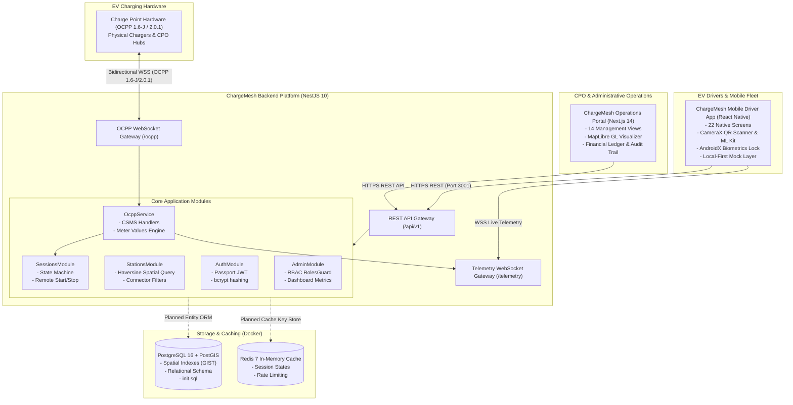

# Overall System Architecture

> **Component:** End-to-End System Context  
> **Source:** ChargeMesh Monorepo Architecture Specification  

This diagram illustrates the high-level architecture of ChargeMesh, mapping user and hardware touchpoints to core services, gateways, and data stores.

