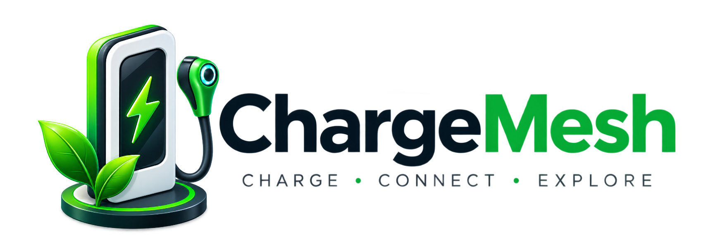
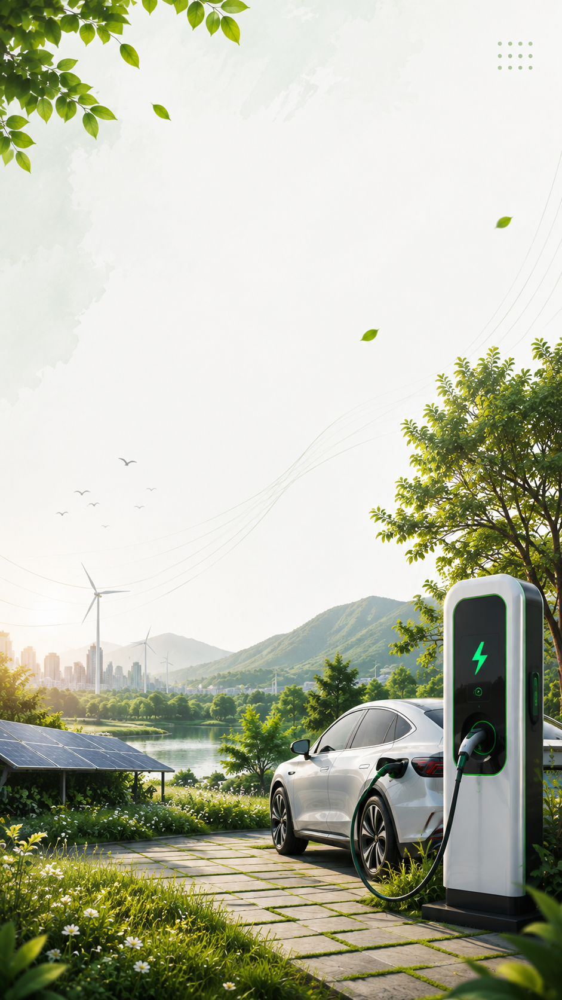

# ChargeMesh — Visual Documentation & Screenshot Gallery

This directory houses verified graphical assets, production visual documentation, and the complete user interface inventory for ChargeMesh.

---

## 1. Verified Brand & Interface Assets

### Project Identity & Logos
| Brand Mark | Web Wordmark |
| :---: | :---: |
|  |  |

### Mobile Onboarding Flow (Genuine Assets)
The onboarding screens introduce EV drivers to the core value propositions of the ChargeMesh platform:

| Screen 1: Multi-Network Discovery | Screen 2: Real-Time Telemetry | Screen 3: Unified Fast Wallet |
| :---: | :---: | :---: |
|  |  |  |
| *Aggregate charging stations across all participating CPOs in India.* | *Live power (kW), battery SoC (%), voltage, and charging curves.* | *One balance for seamless charging sessions across all networks.* |

---

## 2. Complete Application Interface Inventory

The ChargeMesh codebase contains **22 mobile application screens** and **14 admin portal management views**. Below is the verification status and screenshot catalog:

### 2.1 Mobile Application (`apps/mobile`)

| Screen Name | File Path | Key UI Components | Visual Evidence Status |
| :--- | :--- | :--- | :--- |
| **Splash Screen** | `screens/SplashScreen.tsx` | Brand badge, version indicator, auto-navigation | ✅ Asset Available (`splash_bg.png`) |
| **Onboarding Carousel** | `screens/OnboardingScreen.tsx` | 3-step carousel, feature highlights, skip button | ✅ Assets Available (`onboarding_01..03.png`) |
| **Login Screen** | `screens/LoginScreen.tsx` | Phone + OTP / Email + Password, quick demo driver chips | ⏳ Pending Emulator Capture |
| **Register Screen** | `screens/RegisterScreen.tsx` | Full name, phone verification, terms agreement | ⏳ Pending Emulator Capture |
| **Home Screen** | `screens/HomeScreen.tsx` | Active session banner, nearby hubs, quick actions | ⏳ Pending Emulator Capture |
| **Map Screen** | `screens/MapScreen.tsx` | MapLibre GL map, station markers, district search | ⏳ Pending Emulator Capture |
| **Station Detail** | `screens/StationDetailScreen.tsx` | Connector list, live status badge, tariff, directions | ⏳ Pending Emulator Capture |
| **Pre-Charge Screen** | `screens/PreChargeScreen.tsx` | Connector selector, charge limits (SoC % or ₹) | ⏳ Pending Emulator Capture |
| **Live Charging** | `screens/LiveChargingScreen.tsx` | Radial gauge UI (kW, SoC, V, A, cost, time remaining) | ⏳ Pending Emulator Capture |
| **Session Complete** | `screens/SessionCompleteScreen.tsx` | Final invoice, energy consumed, CO₂ saved | ⏳ Pending Emulator Capture |
| **QR Scanner** | `screens/QRScannerScreen.tsx` | Native CameraX viewfinder, barcode overlay, flash toggle | ⏳ Pending Emulator Capture |
| **Activity Screen** | `screens/ActivityScreen.tsx` | Past charging session cards, downloadable receipts | ⏳ Pending Emulator Capture |
| **Profile Screen** | `screens/ProfileScreen.tsx` | Driver profile, app lock toggle, language switch | ⏳ Pending Emulator Capture |
| **My Account** | `screens/MyAccountScreen.tsx` | Personal details, edit vehicle garage, notifications | ⏳ Pending Emulator Capture |
| **My Vehicles** | `screens/MyVehiclesScreen.tsx` | Multi-vehicle list, primary badge, battery capacity | ⏳ Pending Emulator Capture |
| **Add Vehicle** | `screens/AddVehicleScreen.tsx` | Brand & model picker, connector type selector | ⏳ Pending Emulator Capture |
| **Wallet & Ledger** | `screens/WalletTransactionsScreen.tsx` | Running ledger, credit/debit breakdown, GST line items | ⏳ Pending Emulator Capture |
| **Add Money** | `screens/AddMoneyScreen.tsx` | Preset amounts (₹200, ₹500, ₹1000), payment methods | ⏳ Pending Emulator Capture |
| **Payment Methods** | `screens/PaymentMethodsScreen.tsx` | Saved UPI IDs, credit/debit cards, NetBanking | ⏳ Pending Emulator Capture |
| **Eco Sustainability**| `screens/EcoSustainabilityScreen.tsx` | Tree equivalence, green kilometers, CO₂ offset metrics | ⏳ Pending Emulator Capture |
| **Favorites** | `screens/FavoritesScreen.tsx` | Saved favorite chargers with live status chips | ⏳ Pending Emulator Capture |
| **Permission Setup** | `screens/PermissionSetupScreen.tsx` | Location, Camera, Notification permission dialogs | ⏳ Pending Emulator Capture |

### 2.2 Operations Admin Portal (`apps/admin`)

| View Name | File Path | Key Management Capabilities | Visual Evidence Status |
| :--- | :--- | :--- | :--- |
| **Executive Dashboard** | `app/(dashboard)/dashboard/page.tsx` | Active drivers, total CPOs, charger health donut chart | ⏳ Pending Web Capture |
| **Users & Drivers** | `app/(dashboard)/users/page.tsx` | Driver directory, wallet balances, account moderation | ⏳ Pending Web Capture |
| **CPO Networks** | `app/(dashboard)/cpos/page.tsx` | CPO partner registry, sync status, revenue splits | ⏳ Pending Web Capture |
| **Stations & Hubs** | `app/(dashboard)/stations/page.tsx` | Nationwide hubs directory, address, opening times | ⏳ Pending Web Capture |
| **Live Chargers** | `app/(dashboard)/chargers/page.tsx` | Real-time connector states, power ratings, faults | ⏳ Pending Web Capture |
| **Bookings & Slots** | `app/(dashboard)/bookings/page.tsx` | Scheduled charging reservations, slot calendar | ⏳ Pending Web Capture |
| **Charging Sessions**| `app/(dashboard)/sessions/page.tsx` | Active transactions, remote stop triggers, kW curves | ⏳ Pending Web Capture |
| **Finance & Ledger** | `app/(dashboard)/finance/page.tsx` | Daily revenue, tax audit ledger, Razorpay settlement | ⏳ Pending Web Capture |
| **Fast Wallet** | `app/(dashboard)/wallet/page.tsx` | Driver balances, manual credit/debit adjustments | ⏳ Pending Web Capture |
| **EV Master Catalog**| `app/(dashboard)/ev-master/page.tsx` | OEM specifications (Tata, Mahindra, MG, BYD, etc.) | ⏳ Pending Web Capture |
| **Sustainability** | `app/(dashboard)/sustainability/page.tsx`| Fleet CO₂ offset charts, green energy utilization | ⏳ Pending Web Capture |
| **Broadcast Alerts** | `app/(dashboard)/broadcasts/page.tsx` | Push alerts by region or vehicle model | ⏳ Pending Web Capture |
| **Audit Trail** | `app/(dashboard)/audit-logs/page.tsx` | Role-based operation logs with actor IP & diffs | ⏳ Pending Web Capture |
| **Settings & Roles** | `app/(dashboard)/settings/page.tsx` | Admin user permissions, session timeout settings | ⏳ Pending Web Capture |

---

## 3. Screenshot Capture Guide for Contributors

Contributors running local builds are encouraged to capture and submit updated screenshots for the gallery:

### Capturing Android Mobile Screenshots (via ADB)
```bash
# Connect Android Device or start Emulator (API 34)
adb devices

# Take screenshot directly to disk
adb exec-out screencap -p > docs/screenshots/mobile_01_home_screen.png
adb exec-out screencap -p > docs/screenshots/mobile_02_map_screen.png
adb exec-out screencap -p > docs/screenshots/mobile_03_live_charging.png
```

### Capturing Admin Portal Screenshots (via Browser)
1. Run `npm run dev:admin` (accessible at `http://localhost:3001`).
2. Log in using developer credentials (`admin@chargemesh.com` / `admin123`).
3. Use your browser's DevTools screenshot tool (Ctrl+Shift+P > "Capture full size screenshot") and save to `docs/screenshots/admin_dashboard.png`.
