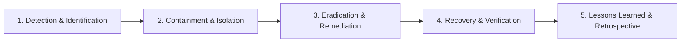

# ChargeMesh — Security Incident Response Plan (IRP)

**Classification:** Operational Security Runbook  
**Applicability:** Core Maintainers, Infrastructure Administrators, and Engineering Leads  

---

## 1. Incident Severity Definitions

| Severity | Description | Target Response Time | Escalation Path |
|:---:|:---|:---:|:---|
| **SEV-1 (Critical)** | Active exploitation of production infrastructure; unauthorized wallet drain; mass denial of EV charging across stations; master secret compromise. | **< 1 hour** | Core Maintainers, Infrastructure Lead, Payment Provider |
| **SEV-2 (High)** | Confirmed exploitable BOLA vulnerability; live database leak; non-functioning charging session terminations; privilege escalation. | **< 4 hours** | Core Maintainers, Backend Lead |
| **SEV-3 (Medium)** | Intermittent rate limit bypass; non-sensitive telemetry exposure; localized station search degradation. | **< 24 hours** | Engineering Team |
| **SEV-4 (Low)** | Minor misconfiguration; cosmetic error message leakage; non-exploitable automated scanner findings. | **< 3 business days** | Standard Sprint Backlog |

---

## 2. Five-Phase Incident Response Process

### Phase 1: Detection & Identification
- Ingestion of alert via GitHub Security Advisory, monitoring alerts, or researcher submission.
- Formally declare incident and assign Incident Commander (Lead Maintainer).
- Create a private, encrypted incident communication channel.

### Phase 2: Containment & Isolation
- **Short-Term Containment:**
  - Revoke affected API tokens, database credentials, or JWT signing keys.
  - Temporarily restrict affected endpoints via API gateway rate limiters or reverse proxy blocking rules.
  - For active financial exploits, suspend wallet debit operations or place affected user accounts on hold.
- **Evidence Preservation:**
  - Preserve immutable server logs, database transaction logs (`finance_ledger`), and network traces.

### Phase 3: Eradication & Remediation
- Identify root cause in application source code or infrastructure configuration.
- Develop, review, and test an authoritative security fix in a private security branch.
- Verify that the patch does not introduce side effects or financial inconsistencies.

### Phase 4: Recovery & Verification
- Deploy patch to staging environment (`beta`) and execute full automated test suite.
- Promote patch to production (`prod`).
- Re-enable suspended services or endpoints.
- Monitor traffic and transaction ledgers for 24–48 hours to confirm operational stability.

### Phase 5: Lessons Learned & Post-Incident Review
- Author an internal Post-Mortem within 5 business days of incident closure.
- Document timeline, root cause, impact, effective containment measures, and areas for improvement.
- Update automated test suites, static analysis rules, or architecture documentation to prevent recurrence.
