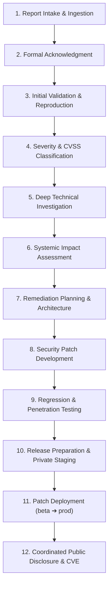

# ChargeMesh — Vulnerability Response & Incident Handling Policy

**Version:** 2.0.0  
**Effective Date:** November 21, 2026  
**Scope:** ChargeMesh Monorepo (`apps/backend`, `apps/mobile`, `apps/admin`, `packages/*`)  
**Target Audience:** Core Maintainers, Security Researchers, Enterprise CPO Operators, and Contributors  

---

## 1. Policy Purpose & Principles

This policy governs the intake, triage, investigation, remediation, and coordinated public disclosure of security vulnerabilities reported in the ChargeMesh platform. 

ChargeMesh operates under four core security principles:
1. **Confidentiality During Triage:** Details of unpatched vulnerabilities are shared strictly on a need-to-know basis among authorized core maintainers.
2. **Prioritization by Risk:** Response timelines and engineering resources are allocated dynamically according to standardized CVSS severity metrics and real-world exploitability.
3. **Safety of Physical & Financial Systems:** Protection of EV drivers, high-voltage charging hardware, and financial transactions takes absolute precedence.
4. **Transparent & Coordinated Disclosure:** Security finders receive transparent communication and appropriate public credit via GitHub Security Advisories.

---

## 2. Secure Reporting Channels

Reporters must use confidential reporting mechanisms. **Never submit vulnerability reports via public GitHub issues, discussions, or pull requests.**

### 2.1 Primary Channel: GitHub Private Vulnerability Reporting
- **Submission URL:** [https://github.com/abhayksingh614/chargemesh-app/security/advisories/new](https://github.com/abhayksingh614/chargemesh-app/security/advisories/new)
- **Advantages:** End-to-end encrypted storage on GitHub infrastructure, private collaborative workspace between researcher and maintainers, automatic CVE assignment capability, and seamless private patch branch creation.

### 2.2 Secondary Fallback: Dedicated Security Email
- **Email:** `security@chargemesh.in`  
- **Cc:** `abhayksingh614@gmail.com` (Core Maintainer Escalation)
- **Subject Format:** `[SECURITY VULNERABILITY] <Component> - <Brief Summary>`

---

## 3. Vulnerability Classification & Severity Rubric

ChargeMesh aligns with the **Common Vulnerability Scoring System (CVSS v4.0 / v3.1)**. Severity is determined not solely by vulnerability class, but by practical exploitability, attacker prerequisite access, environmental exposure, and business impact:

| Severity Tier | CVSS Base Range | Typical Impact in EV Charging Context | Target Acknowledgment | Target Initial Triage | Target Remediation Window |
|:---:|:---:|:---|:---:|:---:|:---:|
| **Critical** | 9.0 – 10.0 | Remote code execution on backend gateway; production database compromise; widespread unauthorized control of high-voltage EVSE chargers; master JWT secret extraction; unauthenticated financial ledger manipulation. | **Within 24–48 hours** | **Within 3 business days** | **7 – 14 business days** |
| **High** | 7.0 – 8.9 | Broken Object-Level Authorization (BOLA) allowing arbitrary session stoppage; privilege escalation from driver to operator admin; double-spend race conditions in wallet; CPO credential exposure; live driver location tracking. | **Within 48 hours** | **Within 5 business days** | **14 – 30 business days** |
| **Medium** | 4.0 – 6.9 | Distributed denial-of-service on station search; authenticated business logic bypass with limited financial scope; non-sensitive telemetry leakage; sub-optimal CORS policies in non-prod configurations; rate-limiting bypass. | **Within 72 hours** | **Within 10 business days** | **30 – 60 business days** |
| **Low** | 0.1 – 3.9 | Minor information leakage (e.g. server banner, package versions); non-exploitable error stack traces; missing non-critical HTTP defense headers; low-impact UI timing variations. | **Within 5 business days** | **Within 15 business days** | **Next scheduled release milestone** |

---

## 4. The 12-Stage Vulnerability Response Lifecycle

### Stage 1: Report Intake & Ingestion
- Inbound submission received via GitHub Private Vulnerability Reporting or security email.
- Internal tracking ticket generated. Access restricted to security maintainers.

### Stage 2: Formal Acknowledgment
- Maintainers acknowledge receipt to the researcher within target SLOs.
- Confirm tracking reference and establish communication channel.

### Stage 3: Initial Validation & Reproduction
- Attempt reproduction against isolated local testbed or containerized environment.
- Confirm whether the behavior is an exploitable vulnerability, an intended feature, or an out-of-scope misconfiguration.

### Stage 4: Severity & CVSS Classification
- Calculate preliminary CVSS v4.0 vector.
- Assign severity tier (Critical, High, Medium, Low).
- Notify reporter of the preliminary triage outcome.

### Stage 5: Deep Technical Investigation
- Trace vulnerability across backend gateway, database models, mobile client, and OCPP message processors.
- Identify all vulnerable code paths, historical commits, and deployment configurations.

### Stage 6: Systemic Impact Assessment
- Determine if any live deployments or driver data could have been affected.
- Audit production telemetry and security logs for evidence of active exploitation.

### Stage 7: Remediation Planning & Architecture
- Design a robust, fail-closed patch that resolves root cause without breaking API backwards compatibility.
- Ensure compliance with India DPDP Act 2023, OCPP protocol specifications, and financial ledger rules.

### Stage 8: Security Patch Development
- Develop fix in a **private GitHub security fork or temporary private advisory branch**.
- Author automated regression tests (`*.spec.ts`) demonstrating the fix and preventing regressions.

### Stage 9: Regression & Penetration Testing
- Execute full monorepo test suite (115 tests across 19 suites).
- Validate TypeScript compilation (`npm run typecheck`) and linting (`npm run lint`).
- Conduct peer code review by at least two maintainers.

### Stage 10: Release Preparation & Private Staging
- Prepare release notes and draft GitHub Security Advisory.
- Coordinate with reporter to review proposed advisory text and credit attribution.
- Request CVE identifier via GitHub Advisory database.

### Stage 11: Patch Deployment (`beta` ➔ `prod`)
- Merge validated security patch into `beta` for staging verification.
- Verify GitHub Actions CI pipelines pass 100%.
- Promote patch to `prod` default branch and cut an annotated release tag (`vMAJOR.MINOR.PATCH`).

### Stage 12: Coordinated Public Disclosure & Post-Incident Review
- Publish the GitHub Security Advisory.
- Notify community via release notes and mailing lists.
- Conduct an internal retrospective to identify process improvements, static analysis rules, or architectural safeguards to prevent similar defects.

---

## 5. Responsible Disclosure & Safe Harbor

### 5.1 Authorized Research Scope
- Local environments: Research executed on local clones, Docker containers (`docker-compose.yml`), and simulated OCPP chargers (`OcppSimulator`).
- Source code auditing: Static analysis, architectural review, and configuration auditing of public repository files.

### 5.2 Strictly Prohibited Activities
1. **Physical EVSE Tampering:** Testing against live, physical EV chargers, grid substations, or commercial charging stations without explicit written authorization from the station operator.
2. **Denial of Service (DoS):** Volumetric flooding, brute-force credential stuffing, or degrading shared infrastructure availability.
3. **Data Exfiltration:** Accessing, modifying, deleting, or retaining personal information (PII) belonging to other drivers or operators.
4. **Social Engineering & Phishing:** Targeting project maintainers, drivers, or CPO personnel.
5. **Extortion:** Demanding payment, compensation, or bounties in exchange for vulnerability disclosure.

### 5.3 Safe Harbor Commitment
If a security researcher conducts vulnerability research in compliance with this policy and demonstrates a good-faith effort to avoid service disruption, privacy violations, and physical hazards:
- The ChargeMesh project maintainers will not initiate or support legal action against the researcher regarding their research activities.
- The project maintainers will collaborate transparently to resolve the issue and provide public attribution in the published security advisory.

*(Note: This Safe Harbor policy reflects project maintainer intent and is subject to applicable Indian and international law).*

---

## 6. Information Required in a Security Report

To facilitate rapid triage, vulnerability reports should include:
- **Affected Component:** Exact workspace and file path (e.g. `apps/backend/src/modules/sessions/sessions.service.ts`).
- **Vulnerability Description:** Detailed technical explanation of the flaw.
- **Proof of Concept (PoC):** Minimal, reproducible steps or test script demonstrating the exploit without harming third parties.
- **Impact Assessment:** Real-world consequences if exploited in production.
- **Remediation Suggestion:** Any proposed patch or architectural mitigation (optional).
- **Prohibited in Reports:** Never attach real production passwords, live driver personal data, or private cryptographic keys.
