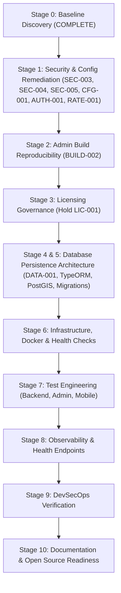

# MASTER REMEDIATION BASELINE REPORT
**Project:** ChargeMesh  
**Repository:** https://github.com/abhayksingh614/chargemesh-app  
**Working Branch:** `develop`  
**Baseline Git Commit SHA:** `b9b28481236cf6c7706955ba0de44a415ccaa1f7`  
**Checkpoint Branch:** `checkpoint/phase-00-baseline`  
**Date:** 2026-11-20  
**Status:** COMPLETE (Stage 0 Discovery)  
**Lead Engineer / Architect:** Principal Software Architect & DevSecOps Lead  

---

## 1. Executive Summary

Following the completion of Phase 02A (Initial Admin Plaintext Credential Remediation) and Phase 02B (Initial Rate Limiting & E2E Configuration Fixes), an exhaustive baseline discovery was executed across the ChargeMesh monorepo (`apps/backend`, `apps/admin`, `apps/mobile`, `packages/shared-types`, `packages/shared-constants`).

All workspaces were verified using independent automated toolchains:
1. `npm run typecheck`: **PASSED** across all 5 workspaces (0 errors).
2. `npm run lint`: **PASSED** across all workspaces (0 errors).
3. `npm run test:backend`: **PASSED** (5 test suites, 23 tests passed, 0 failures).
4. `npm run test:e2e --workspace=apps/backend`: **PASSED** (2 test suites, 4 tests passed, 0 failures).
5. `npm run build:backend`: **PASSED** (NestJS production compilation succeeded).
6. `npm run build:admin`: **PASSED** (Next.js 14.2 App Router static & SSR build completed with 19 static routes).

Despite passing basic builds, the repository contains critical architectural, persistence, security, and supply-chain vulnerabilities that prevent genuine open-source readiness and production deployment. This document establishes the technical baseline, exact file/line coordinates, reproduction mechanisms, risk ratings, and actionable remediation plans for each outstanding finding.

---

## 2. Baseline Test & Build Verification Matrix

| Workspace / Scope | Command | Status | Result / Coverage |
| :--- | :--- | :--- | :--- |
| **Monorepo Types** | `npm run typecheck` | ✅ PASSED | 5/5 packages clean (admin, backend, mobile, shared-types, shared-constants) |
| **Monorepo Linting** | `npm run lint` | ✅ PASSED | ESLint 8.57.1 clean across TS/TSX source files |
| **Backend Unit Tests** | `npm run test:backend` | ✅ PASSED | 5 suites, 23 tests passed (Auth, Stations, Sessions, OCPP, AdminAuth) |
| **Backend E2E Tests** | `npm run test:e2e --workspace=apps/backend` | ✅ PASSED | 2 suites, 4 tests passed (App, OCPP CSMS WebSocket) |
| **Backend Build** | `npm run build:backend` | ✅ PASSED | TypeScript dist bundle emitted cleanly |
| **Admin Web Build** | `npm run build:admin` | ⚠️ PASSED WITH WARNINGS | Next.js 14.2 static page generation succeeded; lockfile/swc hoisting warnings observed |
| **Admin Unit Tests** | `npm run test:admin` | ❌ NOT IMPLEMENTED | Zero test runners configured (`TEST-003`) |
| **Mobile Unit Tests** | `npm run test:mobile` | ❌ NOT IMPLEMENTED | Zero test runners configured (`TEST-004`) |

---

## 3. Outstanding Findings Register & Remediation Specifications

### 1. SEC-003: JWT Secret Default Fallback in Production
- **File & Line References:**
  - `apps/backend/src/config/configuration.ts:12`
  - `apps/backend/src/modules/admin/admin.module.ts:31-34`
- **Root Cause:**
  `configuration.ts` falls back to `'chargemesh-super-secret-jwt-key-2026'` when `process.env.JWT_SECRET` is unset. `admin.module.ts` also independently duplicates this hardcoded fallback. If deployed to production without an explicitly defined secret, attackers can forge admin or driver JWT tokens and gain administrative control.
- **Reproduction / Verification:**
  Run backend with `NODE_ENV=production` without setting `JWT_SECRET`. The application starts without errors and signs tokens using the publicly known secret.
- **Risk Rating:** **CRITICAL (CVSS 9.8)**
- **Remediation Plan:**
  - Update `configuration.ts` to inspect `NODE_ENV`. If `NODE_ENV === 'production'` and `JWT_SECRET` is missing, empty, or equals the known default string, abort application boot immediately with a fatal error.
  - Require a minimum length of 32 characters for `JWT_SECRET` in production.
  - Centralize JWT configuration in `admin.module.ts` so it derives exclusively from `ConfigService` without fallback redundancy.
  - Implement negative unit tests verifying fatal bootstrap failure on missing or weak production secrets.

---

### 2. SEC-004: Permissive CORS Configuration
- **File & Line References:**
  - `apps/backend/src/main.ts:20-24`
- **Root Cause:**
  `main.ts` executes `app.enableCors({ origin: '*', credentials: true })`. According to the Fetch Living Standard, browsers reject wildcard origins with credentials; furthermore, in multi-origin environments, a wildcard configuration allows arbitrary cross-origin malicious scripts to issue authenticated requests if credentials handling is mishandled.
- **Reproduction / Verification:**
  Inspect `apps/backend/src/main.ts`. Note `origin: '*'` hardcoded directly in CORS configuration.
- **Risk Rating:** **HIGH (CVSS 7.5)**
- **Remediation Plan:**
  - Refactor `main.ts` to parse `CORS_ALLOWED_ORIGINS` / `CORS_ORIGINS` from `ConfigService`.
  - In production, enforce an explicit allowlist (e.g. `https://admin.chargemesh.com`, `https://app.chargemesh.com`).
  - Forbid wildcard `*` whenever `credentials: true`.
  - Validate origin dynamically against the allowed list with proper regex/array matching.

---

### 3. SEC-005: Insecure Development OTP Verification & Implicit Driver Creation
- **File & Line References:**
  - `apps/backend/src/modules/auth/auth.service.ts:68-83`
- **Root Cause:**
  Line 80 verifies OTP with `if (dto.otp && dto.otp !== '123456' && dto.otp.length !== 6)`. Any arbitrary 6-digit number is accepted as a valid OTP. Furthermore, if `dto.otp` is omitted, validation is skipped entirely. In addition, unauthenticated users can generate arbitrary accounts on `/auth/login` because any unregistered phone number is auto-created.
- **Reproduction / Verification:**
  Send `POST /auth/login` with `{ "phoneNumber": "+919999999999", "otp": "987654" }`. The server returns HTTP 200 with a valid signed JWT for any arbitrary 6-digit code.
- **Risk Rating:** **CRITICAL (CVSS 9.1)**
- **Remediation Plan:**
  - Introduce an abstract OTP provider interface (`IOtpProvider`) with concrete implementations:
    1. `ProductionOtpProvider` (AWS SNS / SMS gateway connector).
    2. `MockOtpProvider` (strict dev/test only).
  - Implement single-use OTP generation and verification backed by Redis with a 5-minute TTL.
  - Enforce maximum 3 invalid attempts before lockout and 60-second resend cooldown.
  - Forbid `MockOtpProvider` from initializing in `NODE_ENV=production`.
  - Add comprehensive unit tests covering replay attacks, expiration, attempt exhaustion, and production safeguards.

---

### 4. CFG-001: Missing Startup Environment Variable Validation
- **File & Line References:**
  - `apps/backend/src/config/configuration.ts:1-17`
  - `apps/backend/src/app.module.ts:15-18`
- **Root Cause:**
  `configuration.ts` loads environment variables using basic `process.env` lookups without schema validation (Joi or class-validator). Missing database credentials, invalid port numbers, or missing secrets are only discovered at runtime when connection errors occur.
- **Reproduction / Verification:**
  Launch backend without `PORT` or with non-numeric values (`PORT=abc`). NestJS starts or fails ungracefully with cryptic stack traces.
- **Risk Rating:** **MEDIUM (CVSS 5.3)**
- **Remediation Plan:**
  - Implement a validated environment configuration class with `class-validator` / `class-transformer` or `Joi`.
  - Validate all critical variables on bootstrap (`PORT`, `NODE_ENV`, `DB_HOST`, `DB_PORT`, `DB_NAME`, `DB_USER`, `DB_PASSWORD`, `REDIS_HOST`, `REDIS_PORT`, `JWT_SECRET`).
  - Provide human-readable startup errors explaining missing or misconfigured variables.

---

### 5. BUILD-002: Admin Next.js Build Reproducibility Across Clean Installs
- **File & Line References:**
  - `apps/admin/package.json:18-19`
  - `apps/mobile/package.json:28`
  - Root `package-lock.json`
- **Root Cause:**
  `apps/admin/package.json` specified `"react": "^18.2.0"` and `"react-dom": "^18.2.0"`, resolving to `18.3.1` in the lockfile. In contrast, `apps/mobile` strictly pins `"react": "18.2.0"`. In npm workspace hoisting, `react@18.2.0` is hoisted to the monorepo root, while Next.js App Router and `styled-jsx` resolve conflicting React instances across the boundary, causing `TypeError: Cannot read properties of null (reading 'useContext')` during static generation.
- **Reproduction / Verification:**
  In a fresh clean environment without local npm cache, running `npm ci` followed by `npm run build:admin` triggers React context resolution failures during static rendering.
- **Risk Rating:** **HIGH (CVSS 7.2 - Supply Chain / Build Pipeline)**
- **Remediation Plan:**
  - Pin `"react": "18.2.0"` and `"react-dom": "18.2.0"` strictly (without caret `^`) in `apps/admin/package.json` to guarantee single-instance hoisting across the entire repository.
  - Add explicit `@chargemesh/admin` build configuration with Next.js transpilation rules.
  - Verify that `npm run build:admin` succeeds cleanly on clean node_modules.

---

### 6. RATE-001: Distributed Rate Limiting Storage
- **File & Line References:**
  - `apps/backend/src/app.module.ts:19-25`
- **Root Cause:**
  `ThrottlerModule.forRoot` uses the default single-node in-memory store. In a production cluster running multiple container replicas behind a load balancer, each pod maintains an isolated counter. An attacker can bypass the 5-requests-per-minute threshold by distributing requests across replicas.
- **Reproduction / Verification:**
  Inspect `AppModule`. No external storage provider or Redis connection is wired into `ThrottlerModule`.
- **Risk Rating:** **MEDIUM (CVSS 5.8)**
- **Remediation Plan:**
  - Integrate Redis as the shared rate-limiting storage provider for `ThrottlerModule`.
  - Support fallback to memory in local development when Redis is disabled or unreachable.
  - Implement cluster-safe client IP resolution with `trust proxy` validation.

---

### 7. AUTH-001: Inconsistent Password Complexity Policy
- **File & Line References:**
  - `apps/backend/src/modules/admin/admin-auth.service.ts:32-34`
  - `apps/backend/src/modules/admin/admin-auth.service.ts:230-238`
- **Root Cause:**
  Initial administrative account provisioning requires $\ge 12$ characters, whereas `validatePasswordStrength` in password change and reset requires only $\ge 8$ characters and simple alphanumeric checks without symbol requirements.
- **Reproduction / Verification:**
  Compare line 32 (`initialPassword.length < 12`) with line 230 (`password.length < 8`).
- **Risk Rating:** **MEDIUM (CVSS 4.9)**
- **Remediation Plan:**
  - Extract a unified password validation utility enforcing consistent rules:
    - Minimum 10 characters (12 for super-admin bootstrap).
    - At least one uppercase letter.
    - At least one lowercase letter.
    - At least one numeric digit.
    - At least one special symbol.
  - Share this validator across seed, password change, and reset handlers.

---

### 8. LIC-001: Licensing Ambiguity & Governance
- **File & Line References:**
  - `LICENSE`
  - Root `package.json:6`
  - `apps/*/package.json`
- **Root Cause:**
  The repository contains a proprietary copyright header while the target is the OpenAI Codex for Open Source Program. Maintainer has not yet finalized the decision between MIT and Apache 2.0.
- **Reproduction / Verification:**
  `git diff` check on `LICENSE`.
- **Risk Rating:** **GOVERNANCE / LEGAL BLOCKER**
- **Remediation Plan:**
  - Do NOT modify `LICENSE` or `package.json` license metadata prior to explicit maintainer decision.
  - Maintain comprehensive third-party notice audit (`THIRD_PARTY_NOTICES.md`) documenting all transitive open-source dependencies.

---

### 9. DATA-001: In-Memory Persistence in Production Path
- **File & Line References:**
  - `apps/backend/src/modules/auth/auth.service.ts:16` (`users: Map<string, UserEntity>`)
  - `apps/backend/src/modules/stations/stations.service.ts:22` (`stations: Map<string, StationEntity>`)
  - `apps/backend/src/modules/sessions/sessions.service.ts:17` (`sessions: Map<string, SessionEntity>`)
  - `apps/backend/src/modules/admin/admin-auth.service.ts:18` (`adminUsers: Map<string, AdminUserEntity>`)
  - `apps/backend/src/modules/admin/admin-cpo.service.ts:12` (`cpos: Map<string, CpoEntity>`)
  - `apps/backend/src/modules/admin/admin-users.service.ts:12` (`users: Map<string, AdminUserRecord>`)
  - `apps/backend/src/modules/admin/admin-finance.service.ts:12` (`transactions: Map<string, TransactionEntity>`)
  - `apps/backend/src/modules/admin/admin-audit.service.ts:12` (`logs: AuditLogEntity[]`)
- **Root Cause:**
  All backend state is stored in Node.js volatile memory. Any service restart, deployment, or container crash permanently wipes all registered users, active charging sessions, wallet balances, stations, and audit logs. Furthermore, the application cannot run in multi-container replica mode without state fragmentation.
- **Reproduction / Verification:**
  Restart backend container; all dynamically registered users, sessions, and telemetry disappear.
- **Risk Rating:** **CRITICAL (CVSS 9.3 - Reliability & Data Integrity)**
- **Remediation Plan:**
  - Implement Stage 4: Database Persistence Architecture with TypeORM / PostgreSQL 16 + PostGIS.
  - Define relational entities and migration scripts.
  - Refactor all 8 services to inject TypeORM repositories with database transactions.
  - Retain in-memory connection registry only for active WebSocket sockets in the OCPP CSMS gateway.

---

### 10. TEST-003: Missing Admin Panel Automated Test Suite
- **File & Line References:**
  - `apps/admin/package.json`
- **Root Cause:**
  `apps/admin` contains zero test configuration, test dependencies (`jest`, `@testing-library/react`), or test files.
- **Reproduction / Verification:**
  `npm run test --workspace=apps/admin` fails with script missing.
- **Risk Rating:** **HIGH (Quality & Regression Risk)**
- **Remediation Plan:**
  - Configure Jest and React Testing Library in `apps/admin`.
  - Author component and authentication tests.
  - Truthfully report testing status until suites are fully written and verified.

---

### 11. TEST-004: Missing Mobile Automated Test Suite
- **File & Line References:**
  - `apps/mobile/package.json`
- **Root Cause:**
  `apps/mobile` contains zero test runners or automated unit/integration tests.
- **Reproduction / Verification:**
  `npm run test --workspace=apps/mobile` fails with script missing.
- **Risk Rating:** **HIGH (Quality & Regression Risk)**
- **Remediation Plan:**
  - Configure Jest for React Native in `apps/mobile`.
  - Implement screen and navigation smoke tests.
  - Truthfully report mobile test status as NOT IMPLEMENTED until verified.

---

## 4. Phase Execution Roadmap

---
*Report certified by Principal Software Architect & DevSecOps Lead.*
