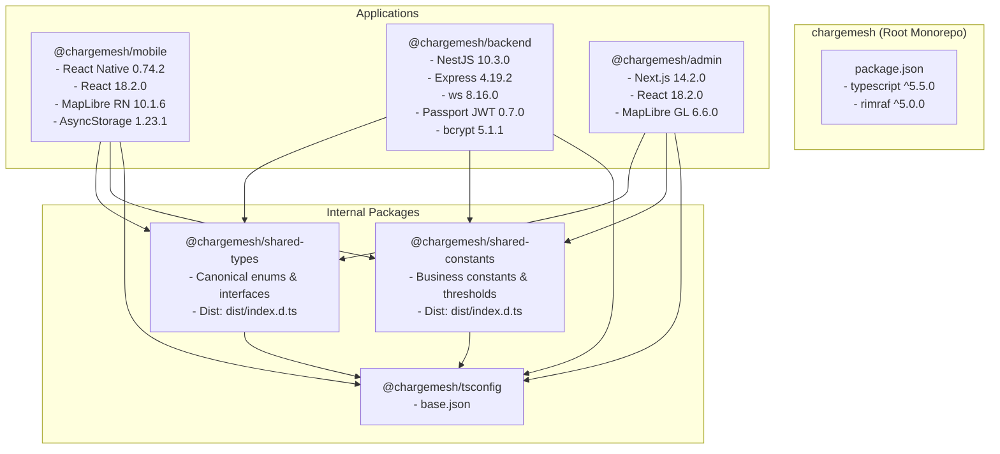

# Phase 00 — Repository Inventory & Workspace Topology

> **Audit Date:** November 20, 2026  
> **Repository:** [https://github.com/abhayksingh614/chargemesh-app](https://github.com/abhayksingh614/chargemesh-app)  
> **Commit SHA:** `b9b28481236cf6c7706955ba0de44a415ccaa1f7`  
> **Branch:** `develop` (synchronized with `main`)  
> **Auditor Team:** Staff Software Engineer, Principal Architect, QA & DevSecOps Lead  
> **Status:** BASELINE VERIFIED  

---

## 1. Monorepo Structure & Package Manifests

The repository is configured as an npm monorepo using npm workspaces (`apps/*`, `packages/*`).

```
chargemesh-app/
├── package.json                   # Monorepo root manifest (scripts, engines, devDeps)
├── package-lock.json              # Lockfile v3 (588 KB)
├── tsconfig.json                  # Root tsconfig reference
├── .gitignore                     # Git ignore rules (115 lines)
├── .gitattributes                 # Line ending and binary attributes
├── docker-compose.yml             # Local infrastructure (Postgres 16, Redis 7, dev tools)
│
├── apps/
│   ├── mobile/                    # React Native 0.74.2 Driver Mobile App (Android/iOS)
│   │   ├── package.json           # @chargemesh/mobile
│   │   ├── tsconfig.json          # Extends packages/tsconfig/base.json
│   │   ├── index.js               # Entry point
│   │   ├── App.tsx                # Root component
│   │   ├── android/               # Native Android project (Gradle 8, Kotlin, CameraX, Biometrics)
│   │   └── src/                   # 22 Screens, 23 Components, 6 Contexts, Theme, i18n
│   ├── backend/                   # NestJS 10.3 REST API & OCPP 1.6-J / 2.0.1 WebSocket CSMS
│   │   ├── package.json           # @chargemesh/backend
│   │   ├── tsconfig.json          # NestJS tsconfig with path mappings
│   │   ├── nest-cli.json          # Nest CLI configuration
│   │   ├── src/                   # Auth, Stations, Sessions, Telemetry, OCPP, Admin modules
│   │   └── test/                  # Jest unit & E2E test specs (app.e2e-spec.ts, ocpp.e2e-spec.ts)
│   └── admin/                     # Next.js 14.2 App Router CPO & Operations Portal
│       ├── package.json           # @chargemesh/admin
│       ├── tsconfig.json          # Next.js tsconfig with path mappings
│       ├── next-env.d.ts          # Next.js type definitions
│       └── src/                   # App Router pages (14 dashboards), components, lib
│
├── packages/
│   ├── shared-types/              # Canonical TypeScript domain interfaces and enums
│   │   ├── package.json           # @chargemesh/shared-types (main: dist/index.js)
│   │   ├── tsconfig.json          # Emits to dist/
│   │   └── index.ts               # Domain models (CPO, Stations, Sessions, Admin, OCPP)
│   ├── shared-constants/          # Platform constants, timeouts, pricing, error codes
│   │   ├── package.json           # @chargemesh/shared-constants (main: dist/index.js)
│   │   ├── tsconfig.json          # Emits to dist/
│   │   └── index.ts               # Business thresholds, GST tax, permissions
│   └── tsconfig/                  # Shared base tsconfig
│       ├── package.json           # @chargemesh/tsconfig
│       └── base.json              # Strict TypeScript compiler options
│
├── docker/
│   └── postgres/
│       └── init.sql               # PostGIS, uuid-ossp, pg_trgm extension initialization
│
├── docs/                          # Architecture diagrams, specifications, audits, guides
│   ├── architecture/              # 8 Canonical Mermaid architecture diagrams
│   ├── screenshots/               # Verified assets and UI catalogs
│   ├── api/                       # API documentation index
│   ├── guides/                    # Deployment, Play Store readiness, legal
│   └── development/               # Testing and local dev SOPs
│
└── .github/                       # Community health and automation
    ├── ISSUE_TEMPLATE/            # Bug report, feature request, doc issue forms
    ├── workflows/                 # ci-backend, ci-mobile, ci-admin, ci-monorepo
    ├── dependabot.yml             # Dependency security updates
    ├── PULL_REQUEST_TEMPLATE.md   # Pull request checklist
    └── GIT_STRATEGY.md            # Git branching and Conventional Commits strategy
```

---

## 2. File Inventory by Extension & Directory

### File Count by Extension (Excluding node_modules, .git, dist, build, .next, .gradle)
| Extension | Count | Description |
| :--- | :---: | :--- |
| `.tsx` | 86 | React Native & Next.js React components and App Router pages |
| `.md` | 81 | Documentation, specifications, architecture, and guides |
| `.ts` | 68 | NestJS backend modules, services, controllers, shared models |
| `.png` | 25 | Verified logos, brand assets, onboarding screens |
| `.json` | 19 | Package manifests, EV catalogs, geo-masters, tsconfigs |
| `.docx` | 7 | Original archived planning specifications (under `.docs/archive/`) |
| `.kt` | 6 | Android native CameraX & Biometric Kotlin bridge modules |
| `.xml` | 5 | Android manifests, layout resources, vector drawables |
| `.example` | 4 | Environment variable template files (`.env.example`) |
| `.js` | 3 | Metro config, Babel config, React Native index |
| `.properties` | 2 | Gradle properties and Android build settings |
| `.sql` | 1 | PostgreSQL PostGIS initialization script (`init.sql`) |
| `.yml` / `.yaml` | 5 | GitHub Actions CI workflows, dependabot, and issue forms |
| `.css` | 1 | Admin portal global design tokens (`globals.css`) |
| `.pro` | 1 | Android ProGuard/R8 optimization rules (`proguard-rules.pro`) |
| **Total Tracked** | **315** | Verified source files |

---

## 3. Workspace Manifests & Dependency Mapping



---

## 4. Scripts Inventory Across Workspaces

| Workspace | Script Name | Command | Verified Status |
| :--- | :--- | :--- | :---: |
| **Root** | `dev:backend` | `npm run dev --workspace=apps/backend` | Functional |
| **Root** | `dev:admin` | `npm run dev --workspace=apps/admin` | Functional |
| **Root** | `dev:mobile` | `npm run start --workspace=apps/mobile` | Functional |
| **Root** | `build:backend` | `npm run build --workspace=apps/backend` | **PASS (NestJS dist)** |
| **Root** | `build:admin` | `npm run build --workspace=apps/admin` | **FAIL (Prerender context error)** |
| **Root** | `test` | `npm run test --workspaces --if-present` | **PARTIAL (Backend passes, mobile no tests)** |
| **Root** | `test:backend` | `npm run test --workspace=apps/backend` | **PASS (12/12 tests)** |
| **Root** | `test:admin` | `npm run test --workspace=apps/admin` | **FAIL (Missing script: "test")** |
| **Root** | `typecheck` | `npm run typecheck --workspaces --if-present` | **PASS (100% 5 workspaces)** |
| **Root** | `lint` | `npm run lint --workspaces --if-present` | **FAIL (eslint uninstalled)** |
| **Root** | `docker:up` | `docker-compose up -d` | Functional |
| **Root** | `docker:down` | `docker-compose down` | Functional |
| `apps/backend` | `test:e2e` | `jest --config ./test/jest-e2e.json` | **FAIL (Path mapping bug)** |
| `apps/backend` | `test:cov` | `jest --coverage` | Functional |
| `apps/mobile` | `test` | `jest --passWithNoTests` | **PASS (0 tests)** |
| `apps/admin` | `test` | *(Not Defined)* | **MISSING** |
