# ChargeMesh — Phase 03 Database Persistence & Repository Architecture
**Document Reference:** `CM-ARCH-DATA-001`  
**Version:** 1.0.0 | Production Architecture Standard  
**Target Environment:** PostgreSQL 16.3 + PostGIS 3.4 Alpine  
**ORM Framework:** TypeORM 0.3.31 + @nestjs/typeorm 10.0.2  
**Database Name:** `chargemesh_dev` (dev/test) / `chargemesh_prod` (production)  

---

## 1. Architectural Overview & Domain Boundary

ChargeMesh has migrated from transient in-memory `Map<string, ...>` storage to an enterprise-grade relational database architecture on PostgreSQL 16 with PostGIS extensions.

```
+-----------------------------------------------------------------------------------+
|                            ChargeMesh Gateway & Core Modules                      |
|  +--------------------+  +--------------------+  +------------------------------+ |
|  |   AuthService      |  |  StationsService   |  |        SessionsService       | |
|  +---------+----------+  +---------+----------+  +--------------+---------------+ |
|            |                       |                            |                 |
|  +---------v----------+  +---------v----------+  +--------------v---------------+ |
|  | AdminAuthService   |  |   AdminCpoService  |  |      AdminFinanceService     | |
|  +---------+----------+  +---------+----------+  +--------------+---------------+ |
+------------|-----------------------|----------------------------|-----------------+
             |                       |                            |
+------------v-----------------------v----------------------------v-----------------+
|                                TypeORM Repository Layer                           |
|  [UserRepository]     [StationRepository]     [SessionRepository]                 |
|  [AdminUserRepository][ConnectorRepository]   [MeterValueRepository]              |
|  [CpoRepository]      [AuditLogRepository]    [FinanceLedgerRepository]           |
+------------------------------------+----------------------------------------------+
                                     |
                                     v
+-----------------------------------------------------------------------------------+
|                        PostgreSQL 16 + PostGIS Relational Storage                 |
|  - Geographic Spatial Indexing (ST_DWithin, ST_MakePoint, GIST)                  |
|  - Financial Double-Entry Reconciliation & Immutable Compliance Audit             |
|  - High-Volume Telemetry Time-Series (MeterValues)                               |
+-----------------------------------------------------------------------------------+
```

### Critical Domain Boundary Rules
1. **Zero Transient Domain State:** All domain models (Users, Admin Users, CPOs, Stations, Connectors, Sessions, Meter Values, Financial Transactions, Audit Logs) persist durably to PostgreSQL.
2. **Ephemeral WebSocket Gateway Exemption:** The active WebSocket connection socket registry (`clients: Map<string, WebSocket>`) in `OcppGateway` remains in-memory, as network sockets cannot be serialized to disk. However, all protocol state (Station status, boot registration, transaction state, meter values) is persisted to PostgreSQL.

---

## 2. Entity-Relationship Diagram (ERD)

```mermaid
erDiagram
    CPOS ||--o{ CHARGING_STATIONS : operates
    CHARGING_STATIONS ||--|{ CONNECTORS : contains
    CHARGING_STATIONS ||--o{ CHARGING_SESSIONS : hosts
    CHARGING_SESSIONS ||--o{ METER_VALUES : records
    USERS ||--o{ CHARGING_SESSIONS : starts
    USERS ||--o{ FINANCE_LEDGER : bills
    CHARGING_SESSIONS ||--o| FINANCE_LEDGER : settles
    ADMIN_USERS ||--o{ AUDIT_LOGS : performs

    USERS {
        varchar id PK
        varchar phoneNumber UK
        varchar name
        varchar email
        jsonb vehicle
        bigint walletBalancePaise
        float totalKwhCharged
        float co2SavedKg
        int totalSessions
        varchar status
        timestamp createdAt
        timestamp updatedAt
    }

    ADMIN_USERS {
        varchar id PK
        varchar email UK
        varchar name
        varchar passwordHash
        varchar role
        varchar status
        varchar department
        timestamp createdAt
        timestamp updatedAt
    }

    CPOS {
        varchar id PK
        varchar partyId
        varchar countryCode
        varchar name
        varchar protocol
        varchar integrationStatus
        varchar supportPhone
        varchar supportEmail
        varchar website
        float revenueSharePercent
        float uptimePercent30d
        int syncFrequencySeconds
        int totalStationCount
        int totalOnlineChargers
        int totalSessionsLifetime
        timestamp lastSyncAt
        jsonb lastSyncResult
        timestamp createdAt
        timestamp updatedAt
    }

    CHARGING_STATIONS {
        varchar id PK
        varchar chargePointId UK
        varchar name
        varchar operator
        varchar cpoId FK
        text address
        varchar city
        float latitude
        float longitude
        float rating
        int totalReviews
        text amenities
        varchar status
        timestamp createdAt
        timestamp updatedAt
    }

    CONNECTORS {
        varchar id PK
        varchar stationId FK
        int connectorNumber
        varchar type
        float powerKw
        varchar status
        float pricePerKwh
        timestamp lastUpdated
    }

    CHARGING_SESSIONS {
        varchar id PK
        varchar userId FK
        varchar stationId FK
        varchar stationName
        varchar connectorId
        varchar connectorType
        varchar chargePointId
        int transactionId
        varchar status
        jsonb target
        timestamp startTime
        timestamp endTime
        float energyKwh
        float totalCostInr
        float pricePerKwh
        float startSoC
        float currentSoC
        float powerKw
        timestamp createdAt
        timestamp updatedAt
    }

    METER_VALUES {
        uuid id PK
        varchar sessionId FK
        varchar chargePointId
        int connectorNumber
        timestamp timestamp
        float powerKw
        float energyKwh
        float socPercent
        float voltage
        float current
    }

    FINANCE_LEDGER {
        varchar id PK
        varchar referenceId
        varchar userId FK
        varchar userName
        varchar type
        varchar title
        float amountRupees
        boolean isCredit
        varchar status
        varchar dateStr
        varchar timeStr
        bigint rawTimestamp
        varchar paymentMethodName
        float balanceBeforeRupees
        float balanceAfterRupees
        text remarks
        boolean reconciled
        timestamp createdAt
    }

    AUDIT_LOGS {
        varchar id PK
        varchar actorId
        varchar actorName
        varchar actorRole
        varchar action
        varchar targetEntity
        varchar targetId
        jsonb previousValue
        jsonb newValue
        text reason
        varchar ipAddress
        timestamp timestamp
    }
```



---

## 3. Data Dictionary & Table Specifications

### 3.1. `users` (EV Drivers)
| Column | Type | Constraints | Description |
| :--- | :--- | :--- | :--- |
| `id` | `VARCHAR(64)` | PRIMARY KEY | Unique driver ID (e.g., `usr-abhay-01`) |
| `phoneNumber` | `VARCHAR(20)` | UNIQUE, NOT NULL | E.164 phone number used for OTP authentication |
| `name` | `VARCHAR(100)` | NOT NULL | Driver display name |
| `email` | `VARCHAR(150)` | NULLABLE | Driver contact email |
| `vehicle` | `JSONB` | NULLABLE | Primary vehicle details (make, model, license, battery) |
| `walletBalancePaise` | `BIGINT` | NOT NULL, DEFAULT 0 | Driver wallet balance in Paise (prevents IEEE-754 float drift) |
| `totalKwhCharged` | `DOUBLE PRECISION` | NOT NULL, DEFAULT 0.0 | Lifetime charging energy in kWh |
| `co2SavedKg` | `DOUBLE PRECISION` | NOT NULL, DEFAULT 0.0 | Calculated CO2 emissions avoided (green metric) |
| `totalSessions` | `INTEGER` | NOT NULL, DEFAULT 0 | Count of completed sessions |
| `status` | `VARCHAR(20)` | NOT NULL, DEFAULT 'ACTIVE' | Driver status (`ACTIVE`, `SUSPENDED`, `PENDING`) |
| `createdAt` | `TIMESTAMP` | NOT NULL, DEFAULT `now()` | Registration timestamp |
| `updatedAt` | `TIMESTAMP` | NOT NULL, DEFAULT `now()` | Last profile modification timestamp |

### 3.2. `admin_users` (Platform Operations & Security)
| Column | Type | Constraints | Description |
| :--- | :--- | :--- | :--- |
| `id` | `VARCHAR(64)` | PRIMARY KEY | Admin user identifier |
| `email` | `VARCHAR(150)` | UNIQUE, NOT NULL | Corporate email for credentials |
| `name` | `VARCHAR(100)` | NOT NULL | Operator full name |
| `passwordHash` | `VARCHAR(255)` | NOT NULL | Bcrypt hash (rounds: 12) |
| `role` | `VARCHAR(30)` | NOT NULL, DEFAULT 'OPERATOR' | RBAC role (`SUPER_ADMIN`, `NETWORK_OPERATOR`, `FINANCIAL_AUDITOR`, etc.) |
| `status` | `VARCHAR(20)` | NOT NULL, DEFAULT 'ACTIVE' | Account state (`ACTIVE`, `SUSPENDED`, `LOCKED`) |
| `department` | `VARCHAR(50)` | NULLABLE | Department name |
| `createdAt` | `TIMESTAMP` | NOT NULL, DEFAULT `now()` | Account creation timestamp |
| `updatedAt` | `TIMESTAMP` | NOT NULL, DEFAULT `now()` | Password update / modification timestamp |

### 3.3. `cpos` (Charge Point Operators)
| Column | Type | Constraints | Description |
| :--- | :--- | :--- | :--- |
| `id` | `VARCHAR(64)` | PRIMARY KEY | Unique CPO identifier (e.g., `cpo-tatapower`) |
| `partyId` | `VARCHAR(10)` | NOT NULL | OCPI 2.2/2.3.0 3-letter party ID (e.g., `TTP`, `STN`) |
| `countryCode` | `VARCHAR(5)` | NOT NULL | ISO 3166-1 alpha-2 country code (`IN`) |
| `name` | `VARCHAR(150)` | NOT NULL | CPO company / brand name |
| `protocol` | `VARCHAR(20)` | NOT NULL | Primary interface (`OCPI_2_2`, `OCPI_2_3`, `PROPRIETARY`) |
| `integrationStatus` | `VARCHAR(20)` | NOT NULL | Status (`ACTIVE`, `PENDING`, `DEGRADED`, `OFFLINE`) |
| `revenueSharePercent` | `DOUBLE PRECISION` | NOT NULL, DEFAULT 85.0 | Platform payout percentage |
| `uptimePercent30d` | `DOUBLE PRECISION` | NOT NULL, DEFAULT 99.0 | SLA uptime score |
| `syncFrequencySeconds` | `INTEGER` | NOT NULL, DEFAULT 300 | Periodic sync cadence (seconds) |
| `totalStationCount` | `INTEGER` | NOT NULL, DEFAULT 0 | Synced stations |
| `totalOnlineChargers` | `INTEGER` | NOT NULL, DEFAULT 0 | Currently active chargers |
| `totalSessionsLifetime` | `INTEGER` | NOT NULL, DEFAULT 0 | Historical sessions |
| `lastSyncAt` | `TIMESTAMP` | NULLABLE | Last OCPI tariff/location pull |
| `lastSyncResult` | `JSONB` | NULLABLE | Structured result (`status`, `synced`, `errorCount`) |

### 3.4. `charging_stations` (Physical EV Stations)
| Column | Type | Constraints | Description |
| :--- | :--- | :--- | :--- |
| `id` | `VARCHAR(64)` | PRIMARY KEY | Station ID (e.g., `st-delhi-001`) |
| `chargePointId` | `VARCHAR(64)` | UNIQUE, NOT NULL | OCPP `chargePointId` used in WebSocket handshake |
| `name` | `VARCHAR(128)` | NOT NULL | Public location name |
| `operator` | `VARCHAR(128)` | NOT NULL | Display operator name |
| `cpoId` | `VARCHAR(64)` | NULLABLE | Associated CPO |
| `address` | `TEXT` | NOT NULL | Street address |
| `city` | `VARCHAR(64)` | NOT NULL, INDEXED | City for regional lookups |
| `latitude` | `DOUBLE PRECISION` | NOT NULL | WGS84 Latitude |
| `longitude` | `DOUBLE PRECISION` | NOT NULL | WGS84 Longitude |
| `rating` | `DOUBLE PRECISION` | NOT NULL, DEFAULT 4.5 | Community rating |
| `totalReviews` | `INTEGER` | NOT NULL, DEFAULT 0 | Review count |
| `amenities` | `TEXT` | NOT NULL, DEFAULT '' | Comma-delimited facilities (WiFi, Cafe, Restroom) |
| `status` | `VARCHAR(32)` | NOT NULL, DEFAULT 'ACTIVE' | Operational status (`ACTIVE`, `MAINTENANCE`, `OFFLINE`) |

### 3.5. `connectors` (Dispensers / EVSE Guns)
| Column | Type | Constraints | Description |
| :--- | :--- | :--- | :--- |
| `id` | `VARCHAR(64)` | PRIMARY KEY | Connector ID (e.g., `st-delhi-001-c1`) |
| `stationId` | `VARCHAR(64)` | NOT NULL, FK, INDEXED | Parent station foreign key (ON DELETE CASCADE) |
| `connectorNumber` | `INTEGER` | NOT NULL | OCPP connector ID (1, 2) |
| `type` | `VARCHAR(32)` | NOT NULL | Plug standard (`CCS2`, `Type2`, `ChaoJi`, `CHAdeMO`) |
| `powerKw` | `DOUBLE PRECISION` | NOT NULL | Maximum DC / AC charging rate |
| `status` | `VARCHAR(32)` | NOT NULL, DEFAULT 'Available' | Real-time status (`Available`, `Occupied`, `Faulted`, `Unavailable`) |
| `pricePerKwh` | `DOUBLE PRECISION` | NOT NULL, DEFAULT 16.50 | Tariff in INR per kWh |
| `lastUpdated` | `TIMESTAMP` | NOT NULL, DEFAULT `now()` | Last telemetry heartbeat |

### 3.6. `charging_sessions` (Active & Historical Sessions)
| Column | Type | Constraints | Description |
| :--- | :--- | :--- | :--- |
| `id` | `VARCHAR(64)` | PRIMARY KEY | Session ID (e.g., `sess-live-01`) |
| `userId` | `VARCHAR(64)` | NOT NULL, INDEXED | Authenticated driver ID |
| `stationId` | `VARCHAR(64)` | NOT NULL, INDEXED | Charging station ID |
| `stationName` | `VARCHAR(128)` | NOT NULL | Human-readable station name snapshot |
| `connectorId` | `VARCHAR(64)` | NOT NULL | Connector ID |
| `connectorType` | `VARCHAR(32)` | NOT NULL | Plug type snapshot |
| `chargePointId` | `VARCHAR(64)` | NOT NULL | OCPP charge point identifier |
| `transactionId` | `INTEGER` | NULLABLE | OCPP transaction ID |
| `status` | `VARCHAR(32)` | NOT NULL, DEFAULT 'ACTIVE' | Lifecycle (`ACTIVE`, `COMPLETED`, `STOPPED`, `FAILED`) |
| `target` | `JSONB` | NULLABLE | Charging target (`{ type: "SOC", value: 80 }`) |
| `startTime` | `TIMESTAMP` | NOT NULL, DEFAULT `now()` | Session initiation |
| `endTime` | `TIMESTAMP` | NULLABLE | Session termination |
| `energyKwh` | `DOUBLE PRECISION` | NOT NULL, DEFAULT 0.0 | Metered energy delivered |
| `totalCostInr` | `DOUBLE PRECISION` | NOT NULL, DEFAULT 0.0 | Calculated billing amount |
| `pricePerKwh` | `DOUBLE PRECISION` | NOT NULL, DEFAULT 16.50 | Applied tariff rate |
| `startSoC` | `DOUBLE PRECISION` | NULLABLE | Initial battery percentage |
| `currentSoC` | `DOUBLE PRECISION` | NULLABLE | Current / final battery percentage |
| `powerKw` | `DOUBLE PRECISION` | NOT NULL, DEFAULT 0.0 | Instantaneous power delivery rate |

### 3.7. `meter_values` (Time-Series Power Telemetry)
| Column | Type | Constraints | Description |
| :--- | :--- | :--- | :--- |
| `id` | `UUID` | PRIMARY KEY, DEFAULT uuid() | Telemetry record ID |
| `sessionId` | `VARCHAR(64)` | NOT NULL, INDEXED | Foreign reference to `charging_sessions` |
| `chargePointId` | `VARCHAR(64)` | NOT NULL | OCPP charge point ID |
| `connectorNumber` | `INTEGER` | NOT NULL | Gun index |
| `timestamp` | `TIMESTAMP` | NOT NULL, INDEXED (DESC) | Reading timestamp |
| `powerKw` | `DOUBLE PRECISION` | NOT NULL | Power delivery in kW |
| `energyKwh` | `DOUBLE PRECISION` | NOT NULL | Cumulative kWh import register |
| `socPercent` | `DOUBLE PRECISION` | NULLABLE | Vehicle State of Charge (%) |
| `voltage` | `DOUBLE PRECISION` | NULLABLE | DC link voltage (V) |
| `current` | `DOUBLE PRECISION` | NULLABLE | DC current (A) |

### 3.8. `finance_ledger` (Double-Entry Billing & Payouts)
| Column | Type | Constraints | Description |
| :--- | :--- | :--- | :--- |
| `id` | `VARCHAR(64)` | PRIMARY KEY | Ledger entry ID (e.g., `tx-cm-101`) |
| `referenceId` | `VARCHAR(64)` | NOT NULL | Payment gateway transaction ID |
| `userId` | `VARCHAR(64)` | NOT NULL, INDEXED | Driver or payee ID |
| `userName` | `VARCHAR(100)` | NOT NULL | Payee name |
| `type` | `VARCHAR(32)` | NOT NULL | Transaction type (`WALLET_TOPUP`, `SESSION_DEBIT`, `CPO_PAYOUT`) |
| `title` | `VARCHAR(150)` | NOT NULL | Ledger description line |
| `amountRupees` | `DOUBLE PRECISION` | NOT NULL | Monetary amount in INR |
| `isCredit` | `BOOLEAN` | NOT NULL | Credit (`true`) vs Debit (`false`) |
| `status` | `VARCHAR(20)` | NOT NULL, DEFAULT 'SUCCESS' | Settlement status (`SUCCESS`, `PENDING`, `FAILED`) |
| `dateStr` | `VARCHAR(30)` | NOT NULL | Human-readable date (`Today`, `Yesterday`) |
| `timeStr` | `VARCHAR(20)` | NOT NULL | Human-readable time (`10:45 AM`) |
| `rawTimestamp` | `BIGINT` | NOT NULL | Epoch milliseconds |
| `paymentMethodName`| `VARCHAR(50)` | NOT NULL | Gateway / channel (`UPI / Razorpay`, `Wallet Balance`) |
| `balanceBeforeRupees`| `DOUBLE PRECISION` | NOT NULL | Running balance before tx |
| `balanceAfterRupees` | `DOUBLE PRECISION` | NOT NULL | Running balance after tx |
| `reconciled` | `BOOLEAN` | NOT NULL, DEFAULT false | Bank settlement reconciliation flag |

### 3.9. `audit_logs` (Immutable Regulatory Compliance)
| Column | Type | Constraints | Description |
| :--- | :--- | :--- | :--- |
| `id` | `VARCHAR(64)` | PRIMARY KEY | Audit log record ID |
| `actorId` | `VARCHAR(64)` | NOT NULL, INDEXED | Admin / Actor UUID |
| `actorName` | `VARCHAR(100)` | NOT NULL | Admin full name |
| `actorRole` | `VARCHAR(30)` | NOT NULL | Admin role snapshot |
| `action` | `VARCHAR(64)` | NOT NULL | Audit action type (`CPO_SYNC_TRIGGER`, `ADMIN_LOGIN`, `STATION_EDIT`) |
| `targetEntity` | `VARCHAR(64)` | NOT NULL | Target table / module (`CPO`, `STATION`, `USER`, `CONFIG`) |
| `targetId` | `VARCHAR(64)` | NULLABLE | Target primary key |
| `previousValue` | `JSONB` | NULLABLE | State before modification |
| `newValue` | `JSONB` | NULLABLE | State after modification |
| `reason` | `TEXT` | NULLABLE | Justification entered by operator |
| `ipAddress` | `VARCHAR(45)` | NULLABLE | Client IPv4 / IPv6 address |
| `timestamp` | `TIMESTAMP` | NOT NULL, INDEXED (DESC) | Immutable action timestamp |

---

## 4. PostGIS Spatial Indexing & Geospatial Queries

### 4.1. Spatial Distance Calculation (Haversine Formula via SQL)
When finding stations within a geographic radius (e.g., driver app location search):
```sql
SELECT 
  id,
  name,
  latitude,
  longitude,
  (
    6371 * acos(
      cos(radians($1)) * cos(radians(latitude)) *
      cos(radians(longitude) - radians($2)) +
      sin(radians($1)) * sin(radians(latitude))
    )
  ) AS distance_km
FROM charging_stations
WHERE status = 'ACTIVE'
ORDER BY distance_km ASC
LIMIT 50;
```

### 4.2. Native PostGIS Geography Optimization
For sub-millisecond lookups across 100,000+ stations, PostGIS `geography` point index:
```sql
-- Create functional spatial index
CREATE INDEX IF NOT EXISTS idx_charging_stations_geom 
ON charging_stations 
USING GIST (ST_SetSRID(ST_MakePoint(longitude, latitude), 4326)::geography);

-- Spatial Query with PostGIS ST_DWithin
SELECT id, name, latitude, longitude
FROM charging_stations
WHERE ST_DWithin(
  ST_SetSRID(ST_MakePoint(longitude, latitude), 4326)::geography,
  ST_SetSRID(ST_MakePoint(:driverLng, :driverLat), 4326)::geography,
  :radiusMeters
);
```

---

## 5. Concurrency Control & Ledger Idempotency

### 5.1. Session Charging Concurrency
To prevent double-charging or race conditions when two mobile clients attempt to start a session on the same connector simultaneously:
- `connectors` table enforces a single active state per connector.
- In `SessionsService.startSession()`, the connector is checked and updated within a database transaction or atomic `UPDATE connectors SET status = 'Occupied' WHERE id = :id AND status = 'Available'`.

### 5.2. Double-Entry Running Balance Invariant
Every transaction in `finance_ledger` records:
$$\text{balanceAfterPaise} = \text{balanceBeforePaise} \pm \text{amountPaise}$$
Float rounding issues are completely eliminated by storing integer Paise on `users.walletBalancePaise`.
Idempotency is guaranteed via the `referenceId` (Payment Gateway Order ID / Transaction ID) unique index.
