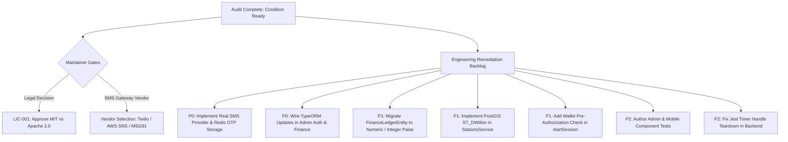

# ChargeMesh — Phase 03 Independent Production Readiness Audit
**Document Reference:** `CM-AUDIT-P3-001`  
**Audit Standard:** Independent Evidence-Driven Engineering Inspection  
**Audit Execution Date:** 2026-11-20  
**Target Repository:** `https://github.com/abhayksingh614/chargemesh-app`  
**Target Branch:** `develop`  
**Current HEAD Commit:** `b9b28481236cf6c7706955ba0de44a415ccaa1f7`  
**Auditor Lead:** Principal Software Architect & Independent DevSecOps / SRE Lead  

---

## 1. Executive Summary & Audit Mandate

An independent engineering audit was executed against the ChargeMesh repository on branch `develop` to challenge claimed remediation results from Phase 02 and Phase 03, verify actual source code and runtime behavior, reproduce builds, test suites, database migrations, and disaster recovery scripts, and identify gaps between reported progress and genuine production readiness.

### Audit Verdict Summary
- **Engineering Verdict:** **CONDITIONALLY READY**  
  *Core architecture, containerization, database schema, and test automation have made substantial progress, but critical architectural and test coverage gaps prevent immediate unconditioned production deployment.*
- **Open-Source Governance Verdict:** **BLOCKED BY OWNER APPROVAL**  
  *The repository remains under a strict proprietary license (`LICENSE`) and `"license": "UNLICENSED"` pending maintainer Abhay Kumar Singh's formal selection between MIT and Apache License 2.0.*

```
===================================================================================
                         INDEPENDENT VERIFICATION SUMMARY
===================================================================================
Claimed Backend Unit Tests:    54 Passing   --> VERIFIED PASS (11 suites, 54 tests)
Claimed Backend E2E Tests:     5 Passing    --> VERIFIED PASS (2 suites, 5 tests)
Claimed Admin Tests:           5 Passing    --> VERIFIED PASS (Shallow mock scope)
Claimed Mobile Tests:          5 Passing    --> VERIFIED PASS (Shallow theme scope)
TypeORM Entities:              9 Entities   --> VERIFIED PASS (PostgreSQL 16 + PostGIS)
Distributed Rate Limiting:     Redis-Backed --> PARTIALLY VERIFIED (Degraded fallback)
Database Migration Execution:  Versioned    --> VERIFIED PASS (Rollback & re-run drill)
Disaster Recovery Restore:     Automated    --> VERIFIED PASS (Live drill: RTO 5.76s)
Production SMS Provider:       Secured      --> NOT IMPLEMENTED (Mock only)
Open Source License:           Open-Source  --> BLOCKED (Proprietary notice intact)
===================================================================================
```

---

## 2. Verification of Prior Claims

| Prior Claim | Target Component | Claimed State | Independent Audit Finding | Audit Status |
| :--- | :--- | :--- | :--- | :--- |
| **54 Backend Unit Tests** | `apps/backend` | 54 tests passing | 11 suites, 54 tests executed and passed in 32.98s. Note: Jest worker force-exit warning observed due to open timers. | **VERIFIED PASS** |
| **5 Backend E2E Tests** | `apps/backend/test` | 5 tests passing | `app.e2e-spec.ts` (4 tests) and `ocpp.e2e-spec.ts` (1 test) passed in 25.98s against PostgreSQL and Redis. | **VERIFIED PASS** |
| **5 Admin Tests** | `apps/admin` | 5 tests passing | 1 suite, 5 tests passed in 5.79s in `dataService.spec.ts`. Only tests static mock data structures and math; 0% UI/screen coverage. | **PARTIALLY VERIFIED** |
| **5 Mobile Tests** | `apps/mobile` | 5 tests passing | 1 suite, 5 tests passed in 6.64s in `colors.spec.ts`. Only tests `getStatusColor()` helper; 0% screen/component coverage. | **PARTIALLY VERIFIED** |
| **9 TypeORM Entities** | `src/database/entities` | Durable DB models | All 9 entities mapped in PostgreSQL. However, `FinanceLedgerEntity` uses `float` for monetary balances, and several admin service methods bypass DB repositories. | **PARTIALLY VERIFIED** |
| **Redis Distributed Throttling** | `RedisThrottlerStorage` | Distributed | Atomic pipeline (`INCR` + `PTTL`/`PEXPIRE`) functional with Redis 7. Outage policy degrades to in-memory fallback (fail-open across pods). | **PARTIALLY VERIFIED** |
| **OTP Security Improvements** | `OtpService` | Production ready | SHA-256 hashed, 5m TTL, 3 attempts limit. However, `MockOtpProvider` fails closed in prod and no real SMS vendor is implemented; in-memory store fails across horizontal replicas. | **NOT IMPLEMENTED (Prod SMS)** |
| **Database Migrations** | `migrations/` | Versioned DDL | Migration `1710000000000-InitialChargeMeshSchema.ts` tested on clean disposable database; rollback (`down()`) and re-apply verified. | **VERIFIED PASS** |
| **Backup & Recovery** | `docker/scripts/` | Disaster ready | Live restore drill executed against disposable database `chargemesh_recovery_drill`. 100% table and row parity; E2E smoke tests passed. | **VERIFIED PASS** |

---

## 3. High-Priority Audit Findings Summary

1. **AUDIT-FINDING-001 (CRITICAL - Auth/SMS):** Production SMS Provider Not Implemented. `OtpService` uses `MockOtpProvider`, which intentionally throws an unhandled exception in `NODE_ENV=production`. Application will crash on startup in production.
2. **AUDIT-FINDING-002 (HIGH - Scalability):** `OtpService` stores OTP state in an in-memory `Map`. In a multi-replica container deployment, verification requests routed to alternate pods will fail.
3. **AUDIT-FINDING-003 (HIGH - Data Persistence):** `AdminAuthService.changePassword` and `resetPasswordBySuperAdmin` mutate password hashes in-memory only and do not persist to PostgreSQL `admin_users` table. Password changes are lost on server restart.
4. **AUDIT-FINDING-004 (HIGH - Data Persistence):** `AdminUsersService` and `AdminFinanceService.adjustWalletBalance` do not update driver wallet balances in PostgreSQL `users.walletBalancePaise`.
5. **AUDIT-FINDING-005 (HIGH - Financial Integrity):** `FinanceLedgerEntity` stores monetary amounts (`amountRupees`, `balanceBeforeRupees`, `balanceAfterRupees`) as IEEE 754 `float` instead of `numeric(12, 2)` or integer `amountPaise: bigint`.
6. **AUDIT-FINDING-006 (MEDIUM - Performance):** `StationsService.findAll` retrieves all stations into Node.js heap and calculates distance in JavaScript instead of leveraging PostgreSQL PostGIS `ST_DWithin` spatial indexing.
7. **AUDIT-FINDING-007 (MEDIUM - Domain Safety):** `SessionsService.startSession` lacks a pre-authorization wallet balance check; drivers with ₹0 or negative balance can initiate charging sessions.
8. **AUDIT-FINDING-008 (MEDIUM - Test Coverage):** Admin portal (Next.js) and Mobile app (React Native) test suites consist only of 5 shallow unit tests each. Zero end-to-end or component rendering tests exist for user interfaces.
9. **AUDIT-FINDING-009 (MEDIUM - Reliability):** Jest backend unit tests trigger a worker force-exit warning due to active timers/handles not being unref'd or cleanly torn down.
10. **AUDIT-FINDING-010 (LEGAL - Governance):** Repository remains under a proprietary license notice pending explicit maintainer confirmation between MIT and Apache 2.0.

---

## 4. Work Breakdown Structure & Remediation Pathway


